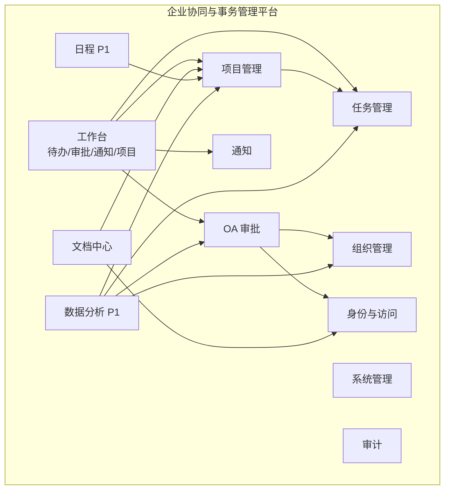
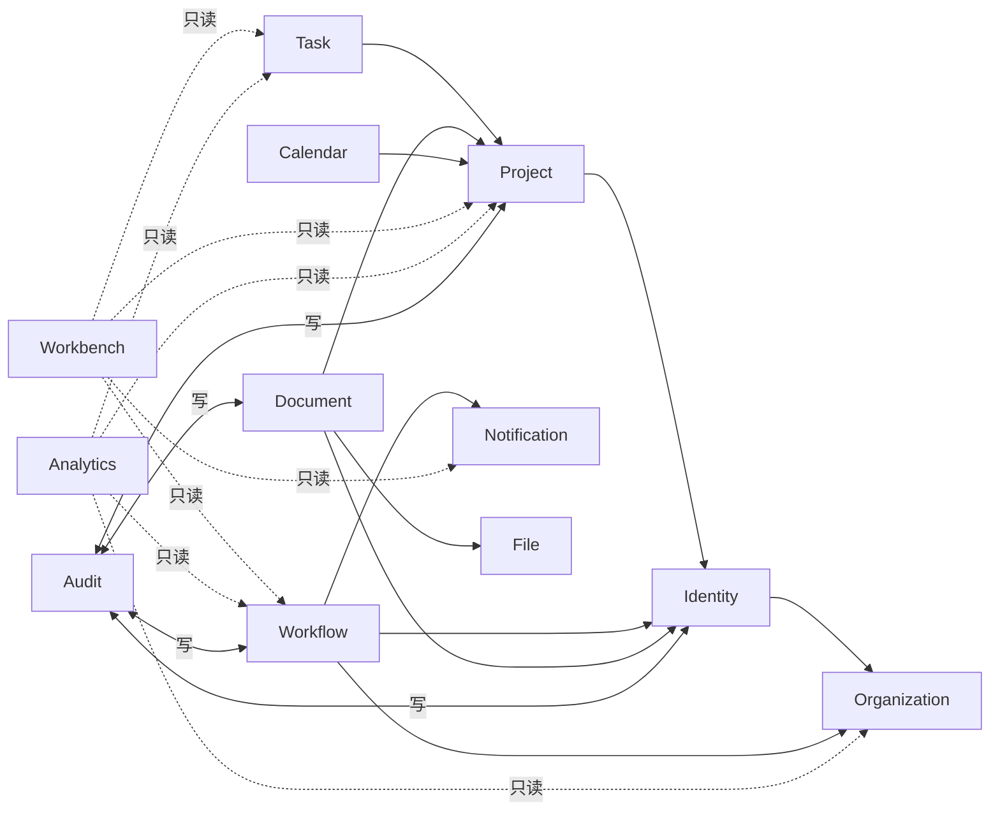
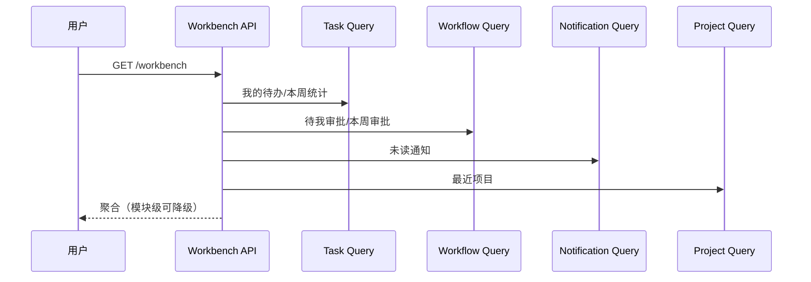

# 业务架构设计

> 文档状态：Draft for Review  
> 版本：0.2.0  
> 日期：2026-10-31  
> 架构风格：单组织 + 模块化单体 + 嵌入式 LMDB + 本地文件系统  
> 关联：[业务流程](business-processes.md)、[权限模型](permission-model.md)、[数据存储设计](../03-technical/data-storage-design.md)

## 1. 目标与约束

1. 单组织部署；无多租户、无组织切换、无 `organizationId`。
2. 一个 Node/Fastify 进程、一个 LMDB 环境、一个 SPA、本地文件目录。
3. 不使用 SQL、ORM、独立数据库服务、Docker。
4. 业务规则在服务/领域层；存储访问统一经 Repository/UnitOfWork。
5. 模块间通过明确接口协作，禁止直接访问对方命名子库。
6. 审批/审计历史只追加；文件与元数据可对账。
7. 单人 + AI 可维护，避免过度设计。

## 2. 业务能力地图



## 3. 领域职责

| 领域 | 职责 | 不负责 | 主要数据（LMDB 子库） |
|---|---|---|---|
| Identity | 登录、会话、账号、角色、权限、登录记录 | 部门/岗位维护、项目成员 | users、sessions、roles、permissions、login_records |
| Organization | 单例组织资料、部门树、岗位、员工雇佣属性 | 密码/角色判定、项目 | org_profile、departments、positions、settings |
| Project | 项目、成员、可见性、生命周期 | 任务状态机、审批 | projects、project_members |
| Task | 任务、看板顺序、进度、评论 | 项目成员/归档 | tasks、task_comments |
| Workflow | 五类申请、模板版本、实例、步骤、审批记录 | 组织架构、通知、文件 | applications、application_attachments、workflow_*、approval_records |
| Document | 文档、版本、分类、标签、ACL、文件元数据 | 项目权限、角色定义 | documents、document_versions、document_categories、tags、document_tags、document_acl、files |
| Calendar（P1） | 事件、参与人、提醒 | 任务/审批 | events、event_reminders |
| Notification | 站内通知、已读 | 业务规则、外部渠道 | notifications |
| Analytics（P1） | 指标口径、只读聚合 | 写业务数据 | 无独立业务库 |
| Audit | 操作日志、哈希链、审计查询 | 业务状态、审批历史 | audit_logs |
| Workbench | 组合读模型 | 独立业务状态 | 无 |
| File | 文件内容、元数据、引用计数、对账 | 文档 ACL | files + data/files |

### 3.1 关键边界

- **Identity vs Organization**：账号/密码/会话归 Identity；部门/岗位/上级归 Organization。`users` 由 Identity 唯一写；Organization 通过内部命令更新雇佣字段，不能改密码/状态。
- **Project vs Task**：项目负责容器/成员/状态；任务负责工作项/进度/评论。项目不直接改任务状态。
- **Workflow vs Organization**：Workflow 读取部门/上级解析审批人，不修改组织。
- **Document vs Project**：项目文档继承项目成员可见性；Document 不修改项目成员。
- **File vs Document**：File 只负责内容/元数据/引用计数；Document 负责业务权限。
- **Audit vs 业务**：业务调用 AuditService；Audit 不反向修改业务。
- **Workbench vs 业务**：只读聚合，不拥有数据。

## 4. 模块依赖



规则：

1. Identity 依赖 Organization（校验部门/岗位/上级）。
2. Project 依赖 Identity（active 用户）。
3. Task 依赖 Project（状态/成员/序号）。
4. Workflow 依赖 Identity/Organization/Notification/Audit。
5. Document 依赖 Identity/Project/File/ACL。
6. Notification 依赖 Identity（接收人）。
7. Analytics/Workbench 是顶层只读，任何领域不得依赖它们。
8. Audit 是叶子，不调用业务模块。
9. 禁止 A→B→A 写依赖；循环用只读 Query Port/应用编排解决。

### 4.1 跨域读写

| 场景 | 规则 |
|---|---|
| 跨域读展示 | 通过 Query Port/只读查询；必须按权限过滤；不直接访问对方 Repository |
| 跨域写 | 调用拥有方应用服务；不得直接写对方子库 |
| 跨域事务 | 发起用例的 UnitOfWork 开启一个 LMDB 写事务；参与方共享事务上下文 |
| 跨域副作用 | 通知/审计在同一事务；外部副作用（邮件/Webhook）P1 用 Outbox |
| 事件 | 首版不建通用事件总线；显式服务调用 |

## 5. 聚合与一致性

| 聚合 | 包含 | 不变量 |
|---|---|---|
| User | users + roleIds | 邮箱唯一；至少 1 角色；最后管理员保护 |
| Role | roles + permissionCodes | 内置不可改；权限码存在；数据范围合法 |
| Department | departments | 无环、深度 ≤10、同父级名称唯一 |
| Project | projects + project_members | owner 唯一；owner 是成员；短键唯一 |
| Task | tasks + comments | 编号唯一；done ⇔ 100%；状态合法 |
| Application | applications + instance + steps + records | 状态一致；单 active 步骤；记录追加 |
| Template | template + versions | 已发布版本不可变；同类型单 active |
| Document | document + versions + ACL/tags + file | 当前版本属于文档；版本号唯一；owner manage |
| Event | event + attendees + reminders | 结束晚于开始；参与人去重 |

### 5.1 事务示例

**提交申请**：

```text
UnitOfWork.run(async tx => {
  校验 applicant/表单/附件/模板
  解析审批人；连续重复合并
  写 application(pending)
  写 workflow_instance(running)
  写 steps（第1步 active，其余 waiting）
  写 notification（当前审批人）
  写 audit_logs
})
```

**审批通过**：

```text
UnitOfWork.run(async tx => {
  读 instance/step（同事务）
  校验 running/active/approver
  追加 approval_record（实例内哈希链）
  更新 step=approved
  若还有下一步：激活下一步 + 通知
  否则：instance/application=approved + 通知申请人
  写 audit_logs
})
```

**文件上传**：

```text
1. 文件写入 tmp → fsync → SHA-256 → 原子 rename 到 files
2. UnitOfWork：files + documents/versions/attachments + 索引 + audit
3. 失败：refCount 回退，无引用删除文件
4. 启动对账：orphan/missing/pending
```

文件系统与 LMDB 无法共享事务；必须补偿 + 对账，不能假装原子。

## 6. 状态机总览

| 对象 | 状态 |
|---|---|
| 项目 | planning/active/on_hold/completed/cancelled/archived |
| 任务 | todo/in_progress/in_review/done/cancelled |
| 申请 | draft/pending/approved/rejected/withdrawn |
| 实例 | running/approved/rejected/withdrawn |
| 步骤 | waiting/active/approved/rejected/cancelled |
| 文档 | active/archived |
| 用户 | active/disabled |

状态变更由服务层方法完成；禁止路由直接改字段；每次变更写审计。

## 7. 数据边界（单组织）

单组织不等于“所有登录用户都能看所有数据”。仍需：

- 用户只能看自己的申请，除非是当前/历史审批人或管理员。
- 部门数据范围：self/department/department_tree/all。
- 私有项目仅成员；组织可见项目只读。
- 项目角色 owner/manager/member/viewer。
- 文档 ACL：user/role/department + view/edit/manage；owner manage。
- 审批只看当前步骤；管理员不能代批。
- 具体资源越权 404；功能无权限 403。

## 8. 工作台读模型



规则：

1. 每模块独立查询，失败降级，不整页 500。
2. 查询按当前用户过滤，不能先全量再前端过滤。
3. 首版实时查询，不做物化视图。
4. 计数与源列表共享查询条件。
5. 首屏限制条数。

## 9. 横切能力

### 9.1 认证
- 会话文档（LMDB）+ Cookie；Fastify preHandler 解析。
- 未登录 401；停用 401；无权限 403/404。

### 9.2 授权
```text
AuthorizationService.can(actor, action, resource, context)
```
- 权限码 + 数据范围 + 项目角色 + 文档 ACL + 审批步骤。
- 服务层执行；前端隐藏仅体验。

### 9.3 审计
- 业务事务内写 audit_logs；全局哈希链。
- 不记录密码/token/文件内容/完整申请正文。
- 查询只读；导出 P1。

### 9.4 通知
- 业务事务内写 notifications；接收人 active。
- 只站内；P1 邮件/IM 用 Outbox。

### 9.5 文件
- FileService 统一管理；内容寻址；下载鉴权；删除延迟。
- 业务模块只传 fileId，不直接写文件路径。

### 9.6 配置
- `settings` 单例；类型/范围代码定义。
- 密钥走环境变量；变更写审计。

## 10. 规则放置

| 层 | 放什么 | 不放什么 |
|---|---|---|
| 路由 | HTTP/认证/序列化 | 业务规则/存储 |
| 应用服务 | 用例/事务/权限/审计/通知 | UI 逻辑 |
| 领域 | 状态机/审批人/ACL/数据范围 | HTTP/LMDB |
| Repository | 文档/索引/分页/事务上下文 | 业务决策 |
| 前端 | 展示/体验校验 | 唯一校验/权限 |

## 11. 反模式

禁止：

- 业务模块直接 `open()` LMDB 或读写 `data.mdb`。
- 每个模块自建 JSON 文件/索引。
- 把所有数据放一个 JSON 文件。
- 无事务地多步写关键业务。
- 把索引当唯一数据源。
- 前端传组织/租户标识决定数据范围。
- 用前端权限隐藏代替后端校验。
- 审批记录 UPDATE/DELETE。
- 工作台复制一套状态。
- 引入 SQL/ORM/Docker/多租户。
- 复制参考产品代码/表结构/UI。

## 12. 演进

| 触发 | 演进 |
|---|---|
| 数据量/查询变复杂 | 增加索引/只读模型；仍不引入 SQL 服务 |
| 全文检索 | 独立索引文件/嵌入式搜索，评估许可证 |
| 多实例 | 需共享存储/锁/队列，重新架构；当前不支持 |
| 多组织 | 产品边界变更，需重新设计；当前不做 |
| 外部集成 | Outbox + 轻量 worker |
| 静态加密 | 评估 LMDB encryptionKey/磁盘加密 |

## 13. 验收

- [ ] 10 个领域职责清晰，数据归属无重叠。
- [ ] 模块依赖无写循环。
- [ ] 每个写用例有 UnitOfWork 事务边界。
- [ ] 所有业务数据经 Repository，无直接 LMDB 访问。
- [ ] 工作台无独立业务库。
- [ ] 单组织，无 organizationId/多租户。
- [ ] 审批/审计只追加。
- [ ] 无 SQL/ORM/Docker。


