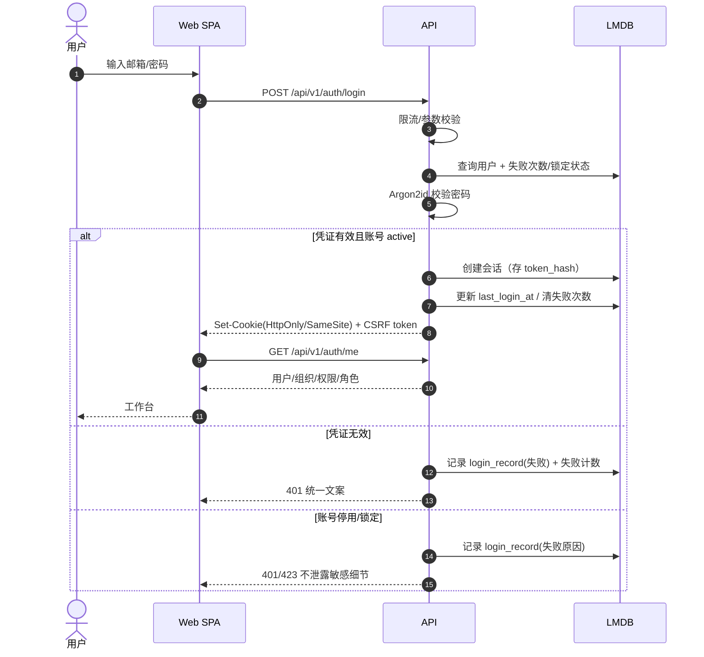
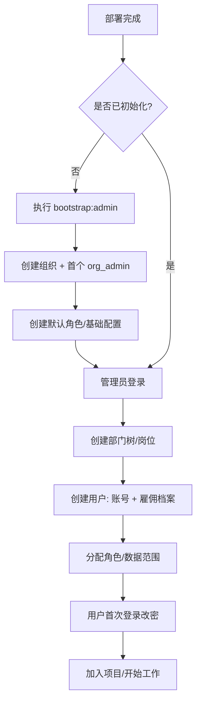
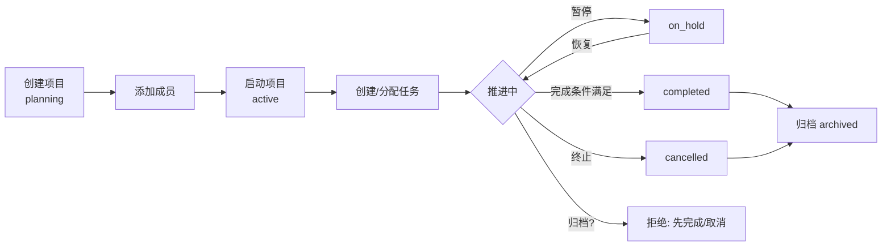
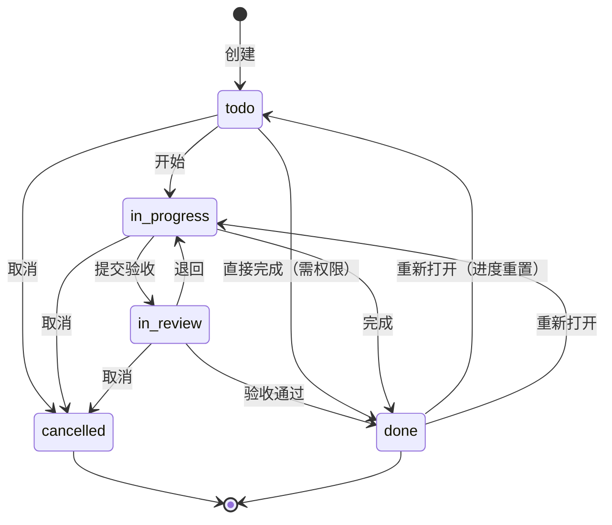
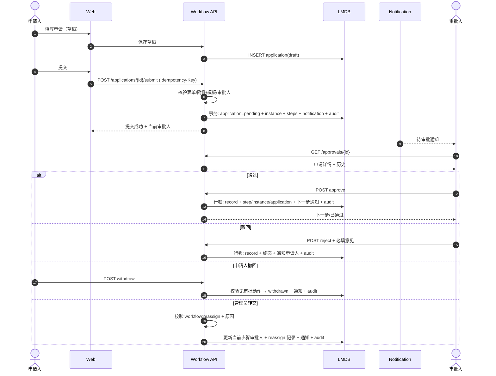
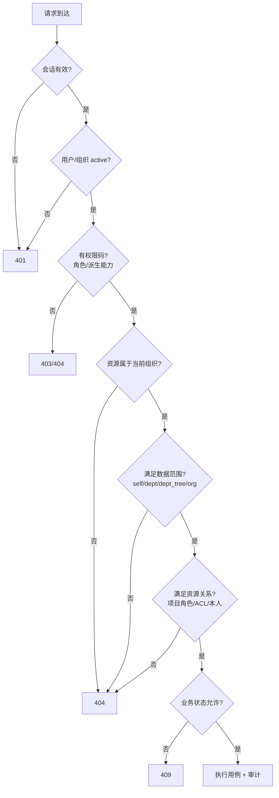
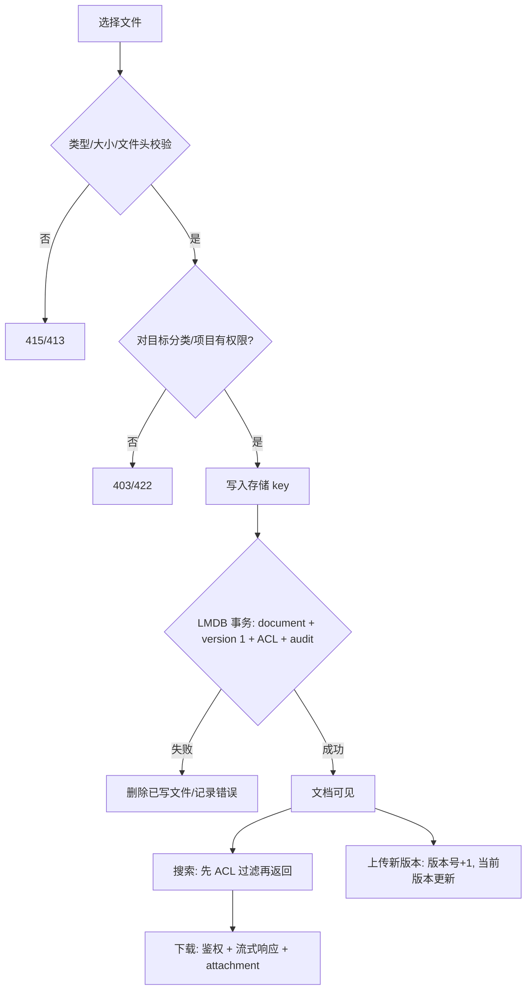
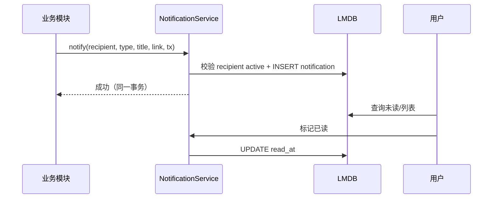
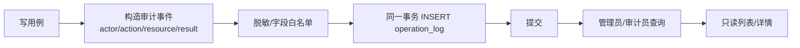
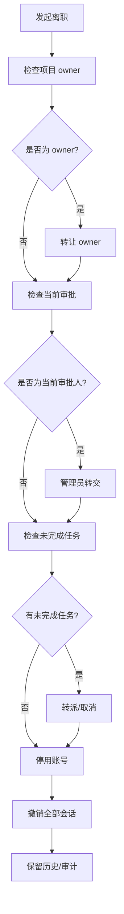

# 核心业务流程

> 文档状态：Draft for Review  
> 版本：0.1.0  
> 日期：2026-10-31  
> 说明：本文描述端到端业务流与异常路径；状态与规则的权威定义在 [项目管理](project-management.md)、[OA 审批](oa-workflow.md)、[权限模型](permission-model.md)。

## 1. 流程目录

| ID | 流程 | 触发 | 主要角色 | 输出 |
|---|---|---|---|---|
| BP-01 | 登录与会话建立 | 用户访问系统 | 全员 | 会话、工作台 |
| BP-02 | 组织初始化与开户 | 首次部署/新员工 | 管理员 | 组织、部门、账号、角色 |
| BP-03 | 项目创建到归档 | 新项目 | 成员/PM/管理员 | 项目、成员、任务、归档 |
| BP-04 | 任务推进 | 工作分派 | 项目成员 | 状态/进度/评论 |
| BP-05 | OA 申请与审批 | 员工发起 | 申请人/审批人/管理员 | 申请终态、审批历史 |
| BP-06 | 权限判定 | 任意受保护请求 | 系统 | 允许/拒绝/404 |
| BP-07 | 文档上传与访问 | 资料沉淀 | 所有者/成员 | 文档、版本、ACL |
| BP-08 | 通知投递 | 业务事件 | 系统 | 站内通知 |
| BP-09 | 审计记录与查询 | 关键写操作 | 系统/审计员 | 操作日志 |
| BP-10 | 离职移交 | 员工离职 | 管理员/PM | 账号停用、项目/审批转移 |

## 2. BP-01 登录与会话建立

异常：

- 连续失败 5 次锁定 15 分钟；IP 限流。
- 临时密码用户登录后只允许访问改密接口。
- 会话过期/撤销 → 401，前端跳登录并保留 returnUrl。
- 已登录但用户被停用 → 下一次请求 401 并撤销会话。

审计：登录成功/失败/锁定、登出、改密、强制下线。

## 3. BP-02 组织初始化与开户

规则：

- 初始化命令幂等；已初始化则拒绝，避免覆盖。
- 不能在 UI 公开注册；首个管理员由运维命令创建。
- 创建用户与员工档案在同一事务；临时密码只显示一次。
- 角色分配不能超过操作者权限；至少保留一个 org_admin。

异常：账号重复 409；部门/岗位无效 422；最后管理员保护 409；临时密码丢失需重置。

## 4. BP-03 项目创建到归档

规则：

- 创建者成为 owner；owner 唯一且必须先转让才能离开。
- 启动要求至少 1 名成员（owner 已满足）。
- 完成要求无 `todo/in_progress/in_review` 任务；否则 409。
- 归档只能从 completed/cancelled；归档后只读。
- 取消可同时取消未完成任务（二次确认）。
- 成员移除前必须处理其未完成任务。

异常与审计：短键冲突、非法状态迁移、无权限、并发版本冲突、归档后写操作。

## 5. BP-04 任务推进

规则：

- `done` ↔ 进度 100 强一致。
- 看板拖拽即状态变更；非法迁移拒绝并回滚 UI。
- 只有 owner/manager 可分配/改期/删除；成员可更新自己创建/被分配任务的状态/进度。
- 评论不改变状态；编辑窗口 15 分钟。
- 任务编号由项目内序列原子生成，删除不复用。

异常：项目归档 → 409；非成员 → 404；并发 → 409；负责人非成员 → 422。

## 6. BP-05 OA 申请与审批

规则与异常：

- 无 active 模板 → 409；审批人解析失败 → 422；申请人=审批人 → 422。
- 重复提交/重复审批 → 409；并发只成功一次。
- 驳回意见必填 10–500 字；通过意见可选。
- 撤回仅无人审批前；撤回后不可再提交。
- 转交只改当前步骤，不改历史。
- 申请终态后不可编辑。

## 7. BP-06 权限判定

说明：

- 菜单/按钮隐藏只是体验，不是安全边界。
- 对具体资源越权返回 404，避免枚举；对页面/功能无权限返回 403。
- 数据范围与资源关系取并集；无显式 deny。
- 审批还要校验“当前步骤审批人”，不是“有审批权限码即可”。

## 8. BP-07 文档上传与访问

规则：

- 存储 key 服务端生成，不使用原始文件名。
- 文件不在 Web 根目录；下载必须过鉴权。
- `organization` 全员可读；`project` 项目成员可读；`restricted` 仅 owner + ACL。
- 项目归档 → 文档只读。
- 版本只追加；首版不支持恢复。
- KV/文件系统无法同一事务：写文件后若 LMDB 失败必须补偿删除；启动/定时对账孤儿文件。

## 9. BP-08 通知投递

规则：

- 通知与业务同事务；业务成功但通知失败不应发生（同一 DB）。
- 通知链接仍受权限校验；目标删除时提示不可访问。
- 首版站内；P1 外部渠道用 Outbox + worker。
- 不做通知模板管理；文案由代码按类型生成。

## 10. BP-09 审计记录与查询

规则：

- 记录“谁、何时、对什么、做了什么、结果、request_id、IP/UA”。
- 不记录密码、令牌、文件内容、完整申请正文。
- 失败操作也记录（如授权失败、越权尝试可记录安全事件）。
- 日志只追加；不提供 UPDATE/DELETE API；文件系统 ACL 限制。
- 查询时间跨度最大 90 天。

## 11. BP-10 离职移交

规则：

- 不能停用最后一个 org_admin；不能停用自己。
- 当前审批人未转交时禁止停用。
- 项目 owner 未转让时禁止停用/移除。
- 历史审批、评论、日志保留，显示“已停用”。

## 12. 异常与补偿总表

| 场景 | 处理 | 用户可见结果 |
|---|---|---|
| LMDB 事务失败 | 回滚；文件写入则补偿删除 | 5xx + request_id，可重试 |
| 通知写入失败 | 业务事务回滚（同库） | 操作失败，可重试 |
| 文件写入失败 | 不创建文档；清理临时文件 | 上传失败 |
| 文件写入成功、DB 失败 | 删除文件；记录错误 | 上传失败 |
| 审批并发 | 行锁/条件更新；失败方 409 | “已被处理，请刷新” |
| 用户被停用时有进行中审批 | 禁止停用，先转交 | 409 + 申请列表 |
| 项目有未完成任务时完成 | 拒绝 | 409 + 数量 |
| 会话过期 | 401 | 跳登录，保留 returnUrl |
| 无权限资源 | 404 | 不泄露存在性 |
| 审计写入失败 | 业务事务回滚（强一致） | 操作失败；记录错误 |

## 14. 流程验收映射

| 流程 | 验收标准 |
|---|---|
| BP-01 | 登录/锁定/改密/会话撤销 |
| BP-02 | 初始化、开户、角色分配、首次改密 |
| BP-03 | 项目闭环 E2E |
| BP-04 | 任务/看板/进度/评论 E2E |
| BP-05 | OA 闭环 + 并发 + 驳回/撤回/转交 |
| BP-06 | 权限矩阵 + IDOR |
| BP-07 | 文档闭环 + 越权 |
| BP-08 | 通知触发/已读/失效链接 |
| BP-09 | 审计覆盖率/不可篡改 |
| BP-10 | 离职检查清单 |

