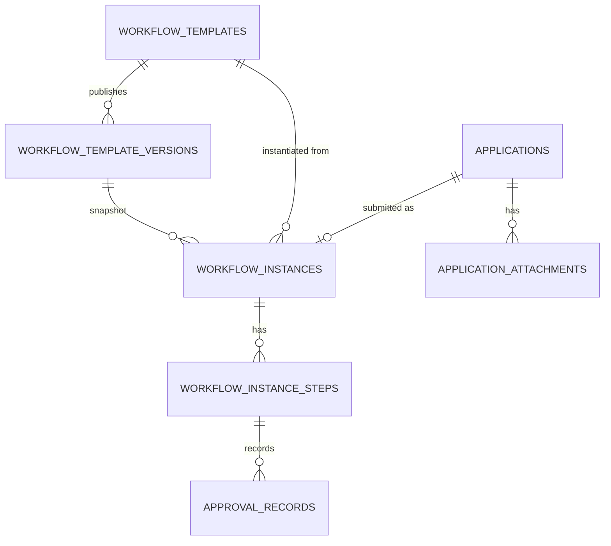
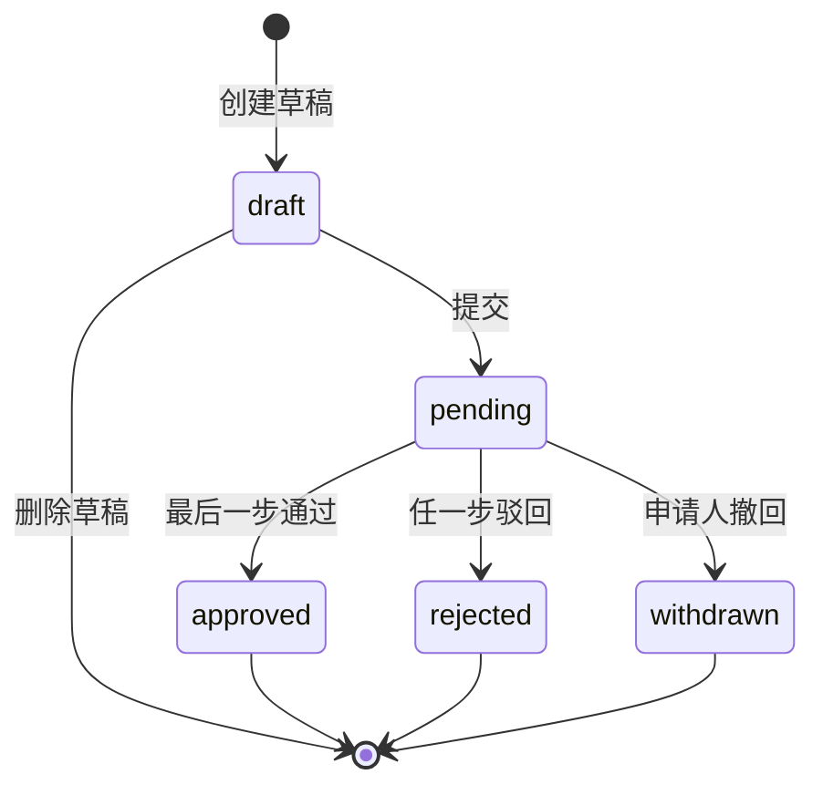
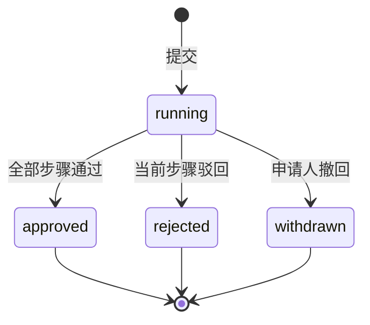
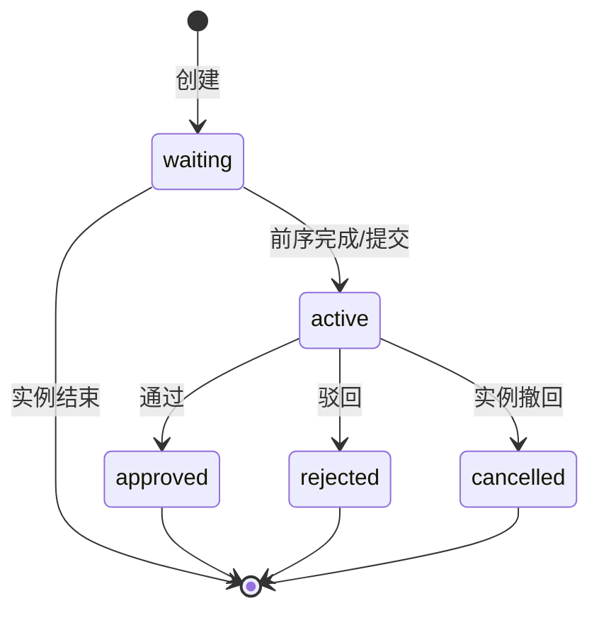

# OA 审批业务规则

> 文档状态：Draft for Review  
> 版本：0.1.0  
> 日期：2026-10-31  
> 关联：[产品需求](../01-product/product-requirements.md)、[业务流程](business-processes.md)、[权限模型](permission-model.md)、[数据存储设计](../03-technical/data-storage-design.md)

## 1. 范围与结论

R1 实现一个**轻量、顺序、单审批人**的审批引擎，覆盖请假、出差、外勤、用印、通用事务五类申请。

明确不支持：

- 会签（多人全部通过）、或签（任一人通过）；
- 条件分支、并行网关、子流程；
- 加签、转交（用户自主）、委托、自动通过；
- BPMN 设计器、脚本节点、外部服务节点。

管理员可在异常情况下**转交当前步骤**（rescue reassignment），这不是用户委托，必须有权限、原因和审计。

## 2. 核心模型



| 对象 | 作用 | 不可变字段 |
|---|---|---|
| Application | 申请主数据、表单、状态 | 申请人、类型、提交后的表单、申请编号 |
| Template | 某类申请的审批配置容器 | 类型、所属组织 |
| Template Version | 发布时的步骤快照 | 版本号、步骤定义、发布人/时间 |
| Instance | 一次审批运行 | 模板版本、申请、开始时间 |
| Instance Step | 解析后的步骤与审批人 | 步骤序号、审批人类型、解析后的审批人（转交例外） |
| Approval Record | 审批动作历史 | 所有字段（只追加） |
| Attachment | 申请附件元数据 | 文件、上传人、大小、哈希 |

## 3. 申请编号与表单版本

### 3.1 申请编号

- 格式：`OA-YYYYMMDD-XXXX`，如 `OA-20261103-0007`。
- 按部署 + 日期递增；使用 `counters` 键 `application\u001FYYYYMMDD` 在同一 LMDB 事务内原子递增。
- 申请编号唯一，仅用于展示与检索，不作为主键。
- 跨天/并发不重复；删除草稿不回收编号（草稿可暂不分配编号，提交时分配）。

### 3.2 表单 schema 版本

- 每个类型有 `formSchemaVersion` 整数，定义在 `app/shared`。
- 提交时写入版本号；历史申请按当时版本渲染，不因代码升级丢字段。
- 新增字段必须可选或有默认值；删除字段不能直接删，需保留只读展示。
- 表单数据存 `formData` JSON 文档；日期范围另存 `startAt/endAt` 便于索引与重叠校验。
- 关键字段（申请人、状态、时间、编号）不进 JSON。

## 4. 五类申请表单

### 4.1 公共字段

| 字段 | 类型 | 规则 |
|---|---|---|
| `type` | enum | leave/travel/field/seal/general，提交后不可改 |
| `title` | string | 2–100 字，默认由类型 + 申请人 + 日期生成，可改 |
| `formData` | object | 按类型 schema 校验 |
| `startAt` / `endAt` | timestamptz? | 有时间的类型必填 |
| `attachments` | array | 0–5，单文件 ≤10MB，PDF/JPG/PNG |
| `projectId` | uuid? | 可选，必须是有权限的未归档项目 |

### 4.2 请假 `leave`

| 字段 | 必填 | 规则 |
|---|---|---|
| `leaveType` | 是 | 年假/病假/事假/调休/婚假/产假/陪产假/丧假 |
| `startAt` | 是 | 组织时区；结束晚于开始 |
| `endAt` | 是 | 最长 365 天 |
| `durationDays` | 是 | 0.5 步长；申请人填写；首版不自动排除周末/节假日、不扣余额（P1 工作日历） |
| `reason` | 是 | 10–500 字 |
| `handoverUserId` | 否 | 同组织 active，不能是本人 |
| `attachments` | 否 | 病假建议证明，不强制 |

重叠规则：同一申请人、类型 `leave`、状态 `pending/approved`，若 `[start,end)` 与已有区间重叠，提交 409 并返回冲突区间。已撤回/驳回/取消不阻止。

### 4.3 出差 `travel`

| 字段 | 必填 | 规则 |
|---|---|---|
| `destination` | 是 | 2–100 字 |
| `purpose` | 是 | 10–500 字 |
| `startAt` / `endAt` | 是 | 结束晚于开始；最长 180 天 |
| `transport` | 是 | plane/train/car/other |
| `estimatedCost` | 否 | 0–1,000,000，2 位小数，CNY |
| `projectId` | 否 | 有权限的未归档项目 |
| `attachments` | 否 | 邀请函/行程单等 |

不阻止与其他出差重叠，但前端提示；不做行程预订/报销。

### 4.4 外勤 `field`

| 字段 | 必填 | 规则 |
|---|---|---|
| `location` | 是 | 2–100 字 |
| `purpose` | 是 | 10–500 字 |
| `startAt` / `endAt` | 是 | 结束晚于开始；最长 7 天 |
| `projectId` | 否 | 有权限的未归档项目 |
| `attachments` | 否 | 现场照片等 |

不自动生成考勤记录（P1 集成）。

### 4.5 用印 `seal`

| 字段 | 必填 | 规则 |
|---|---|---|
| `documentName` | 是 | 2–100 字 |
| `sealType` | 是 | company/contract/finance/other |
| `copies` | 是 | 1–100 整数 |
| `purpose` | 是 | 10–500 字 |
| `expectedDate` | 是 | 纯日期，不得早于今天（组织时区） |
| `recipient` | 是 | 2–50 字，可手填 |
| `attachments` | 是 | 必须 1 个待用印文件（PDF/JPG/PNG，≤10MB） |

不做印章库存、核销、电子签章。

### 4.6 通用事务 `general`

| 字段 | 必填 | 规则 |
|---|---|---|
| `subject` | 是 | 2–100 字 |
| `content` | 是 | 10–2000 字 |
| `expectedDate` | 否 | 不得早于今天 |
| `projectId` | 否 | 有权限的未归档项目 |
| `attachments` | 否 | 0–5 |

不得用通用表单承载付款、合同、采购审批；这些属于后续扩展。

## 5. 模板与版本

### 5.1 模板状态

| 状态 | 含义 | 可提交新申请 |
|---|---|---|
| `draft` | 草稿，可编辑 | 否 |
| `active` | 已发布，当前使用 | 是 |
| `inactive` | 停用，保留历史 | 否 |

约束：

- 同一组织 + 申请类型，最多 1 个 `active` 模板（部分唯一索引）。
- 模板不物理删除；只能停用。被实例引用的版本不可删除。
- 模板名称 2–50 字；类型创建后不可改。

### 5.2 版本

- 发布模板生成 `version_no = 1..N`；`steps` 以 JSON 文档存储并不可变。
- 每次修改必须创建新版本（复制旧步骤 → 修改 → 发布）；不能直接改已发布版本。
- 发布新版本时，原 active 版本保留，`workflow_templates.active_version_id` 指向新版本；新申请用新版本。
- 进行中的实例引用旧 `templateVersionId`，不受影响。
- 停用模板：`status=inactive`；进行中实例继续。

### 5.3 步骤定义

```json
{
  "steps": [
    { "stepNo": 1, "name": "直属上级审批", "approverType": "direct_manager", "userId": null },
    { "stepNo": 2, "name": "部门负责人审批", "approverType": "department_manager", "userId": null }
  ]
}
```

校验：

- 1–10 步；`stepNo` 连续从 1 开始。
- `name` 1–50 字。
- `approverType` ∈ `user | department_manager | direct_manager`。
- `approverType=user` 时 `userId` 必填且为同组织 active 用户；其他类型 `userId` 必须为空。
- 不允许重复 `stepNo`。

### 5.4 默认模板

bootstrap 创建以下 active 模板（管理员可在上线前调整）：

| 类型 | 默认步骤 |
|---|---|
| 请假 | 直属上级 → 部门负责人 |
| 出差 | 直属上级 → 部门负责人 |
| 外勤 | 直属上级 |
| 用印 | 部门负责人 |
| 通用事务 | 部门负责人 |

注意：

- 若直属上级与部门负责人是同一人，提交时连续重复步骤合并，只保留一个。
- 若组织尚未配置上级/部门负责人，提交会失败并提示具体缺失；不静默跳过。
- 默认模板不代表适用于所有部署，管理员应在试点前审查。

## 6. 审批人解析

提交时一次性解析**所有步骤**，写入实例步骤快照。之后组织变更、模板变更不影响该实例。

### 6.1 规则

| 类型 | 解析 |
|---|---|
| `user` | 模板中的固定 `userId`；必须 active、同组织 |
| `direct_manager` | 申请人 `users.manager_id`；必须 active、同组织 |
| `department_manager` | 申请人提交时 `department_id` 对应部门的 `manager_id`；必须 active、同组织 |

失败条件：

- 为空；
- 用户不存在/停用/不属于本部署；
- 解析结果 = 申请人；
- 部门不存在/已删除。

失败时提交整体失败（422 `APPROVER_UNRESOLVED`），错误中指明步骤序号/名称，不创建实例。

### 6.2 连续合并

- 相邻步骤解析为同一审批人时，合并为一步；步骤名取前者，`source_step_nos` 记录在 `metadata`（可选）。
- 合并不改变模板定义；只影响实例步骤。
- 非相邻重复不合并（同一人可能在多阶段审批）。

### 6.3 快照

实例步骤保存：

- `step_no`：生效后的连续序号；
- `name`；
- `approver_type`；
- `approverId`：解析后的用户；
- `status`；
- `activated_at/completed_at`。

## 7. 状态机

### 7.1 申请



### 7.2 实例



### 7.3 步骤



> 步骤状态包含 `cancelled`，用于撤回时显式关闭当前步骤；不要留下“实例已撤回但步骤仍 active”的脏状态。

## 8. 提交

### 8.1 前置校验

1. 申请属于当前用户、状态 `draft`。
2. 表单按 `type + formSchemaVersion` 校验通过。
3. 附件属于该申请、未删除、数量/类型/大小合法；用印必须 1 个。
4. 项目（如有）存在、未归档、用户有访问权。
5. 请假时间不重叠。
6. 存在 active 模板版本且步骤有效。
7. 所有审批人可解析。
8. 申请人 active、组织 active。
9. `Idempotency-Key` 未使用（同一用户/请求体）。

### 8.2 事务

```text
BEGIN
  1. 分配 applicationNo（counters 原子递增）
  2. UPDATE application SET status=pending, submitted_at=now(), ...
  3. INSERT workflow_instance(running, currentStepNo=1, template_version)
  4. INSERT steps（第 1 步 active，其余 waiting）
  5. INSERT notification（第 1 步审批人）
  6. INSERT operation_log(application.submitted)
COMMIT
```

失败：全部回滚；已上传附件保留为草稿附件，可重试。

### 8.3 幂等

- 客户端提交时带 `Idempotency-Key`（UUID）。
- 服务端存 `idempotency` 键 `userId\u001Fkey` → 申请 ID/响应哈希；24 小时有效。
- 同 key 同请求体 → 返回第一次结果；同 key 不同请求体 → 409。
- 子库：`idempotency`（见数据存储设计）。

## 9. 审批动作

### 9.1 通过

- 仅当前步骤审批人。
- 意见可选，0–500 字。
- 事务：
  1. 在同一 LMDB 写事务内读取 instance/step；
  2. 校验 `instance=running`、`step=active`、`approver=actor`；
  3. `INSERT approval_record(action=approve, comment)`；
  4. `UPDATE step=approved, completed_at`；
  5. 有下一步：下一步 `active`，`currentStepNo+1`，通知下一步审批人；
  6. 无下一步：实例/申请 `approved`，`completed_at`，通知申请人；
  7. 审计。
- 重复/并发：只有一个成功；其他 409。

### 9.2 驳回

- 仅当前步骤审批人。
- 意见必填 10–500 字。
- 事务：记录 → step rejected → instance rejected → application rejected → 通知申请人 → 审计。
- 后续步骤保持 `waiting`，不再激活；历史显示“未激活”。
- 驳回是终态；可复制新建。

### 9.3 撤回

- 仅申请人；`pending`；尚无 `approve/reject` 记录。
- 需二次确认；可填原因 0–500 字。
- 事务：记录 `withdraw` → 当前步骤 `cancelled` → 实例/申请 `withdrawn` → 通知当前审批人（若存在）→ 审计。
- 撤回后不可再次提交；可复制新建。
- 管理员不能替申请人撤回（避免越权）；如申请人离职，由管理员转交/完成流程，不自动撤回。

### 9.4 管理员转交（异常处理）

- 权限：`workflow:reassign`（仅 org_admin 默认拥有）。
- 条件：实例 running；当前步骤 active；新审批人 active、同组织、不是申请人、不是当前审批人。
- 输入：`new_approverId`、`reason` 5–500 字。
- 事务：`INSERT approval_record(action=reassign, metadata={from,to,reason})` → `UPDATE step.approverId` → 通知新审批人 → 审计。
- 可多次转交；每次留记录。
- 不改变步骤序号、不重置已通过步骤。
- 非当前步骤/已结束 → 409。

### 9.5 禁止动作

- 管理员直接修改申请状态/表单/审批人历史。
- 审批人“批量通过”他人待办（首版不做）。
- 申请人删除已提交申请。
- 任何人删除审批记录。
- 通过后撤销（只能走新的反向申请/P1）。

## 10. 并发与一致性

- 使用 LMDB 写事务：事务内读取实例/当前步骤；写事务串行，天然避免并发覆盖。
- 或文档 `version` 乐观锁/状态校验；冲突 → 409。
- 审批记录唯一约束兜底：一个步骤最多一条 `approve/reject`。
- 实例与申请状态必须在同一事务更新；不允许只改一个。
- 当前步骤唯一 active：部分唯一索引 `(instanceId) WHERE status='active'`。
- 步骤序号唯一：`UNIQUE(instanceId, step_no)`。
- 撤回与审批并发：谁先获得锁谁成功；另一个 409。

## 11. 可见性与隐私

| 角色 | 可见范围 |
|---|---|
| 申请人 | 自己的全部申请与历史 |
| 当前审批人 | 被分配且进行中的申请详情 |
| 历史审批人 | 自己参与过的申请（只读） |
| 部门负责人 | 不自动看本部门全部申请；仅作为审批人时可见 |
| 组织管理员 | 全组织申请（治理需要，审计） |
| 审计员 | 审批结果摘要/时间线，不含敏感正文；如需正文由 org_admin 临时授权 |
| 其他人 | 404 |

附件权限随申请：有申请查看权即可下载；下载写审计。

## 12. 通知

| 事件 | 接收人 | 文案要点 |
|---|---|---|
| 提交 | 当前审批人 | 谁提交了什么，去审批 |
| 步骤通过 | 下一审批人 | 前一步已通过，待你审批 |
| 最终通过 | 申请人 | 申请已通过 |
| 驳回 | 申请人 | 被谁驳回、意见 |
| 撤回 | 当前审批人 | 申请人已撤回 |
| 转交 | 新审批人 | 某申请转交给你，原因 |
| 转交 | 申请人（可选） | 审批人已变更 |

通知与业务同事务；点击时仍校验权限。

## 13. 审批历史

- 来源：`approval_records` + 实例步骤 + 申请提交时间。
- 顺序：提交 → 各动作按时间正序。
- 内容：步骤、动作、操作人（含停用标记）、时间、意见、转交前后审批人。
- 未激活步骤显示“等待中”，不显示审批人。
- 记录不可编辑/删除；纠错只能追加说明（P1）或受控运维。
- 审批意见对申请人可见；内部备注字段首版不做。

## 14. 审批耗时口径

- 单次审批耗时 = `completed_at - submitted_at`，按自然小时。
- 进行中 = `now - submitted_at`。
- P1 引入工作日历后按工作小时；历史数据不重算，报表标注口径。
- 不把“等待审批人”与“审批人处理时间”拆分（P1 可基于记录计算）。

## 15. 边界与异常

| 场景 | 处理 |
|---|---|
| 无 active 模板 | 409 `WORKFLOW_TEMPLATE_MISSING`，提示管理员配置 |
| 审批人为空/停用 | 422 `APPROVER_UNRESOLVED`，指出步骤 |
| 审批人是申请人 | 422 `SELF_APPROVAL_FORBIDDEN` |
| 模板步骤为空 | 发布校验失败 |
| 重复发布同类型 active 模板 | 409 |
| 进行中实例遇到模板停用 | 继续，不受影响 |
| 审批人停用 | 用户停用被阻止；若已停用，管理员转交 |
| 申请人停用 | 实例继续；通知可能失败但不回滚审批；管理员可转交/完成 |
| 部门负责人变更 | 进行中实例不变；新申请用新负责人 |
| 申请人部门变更 | 实例快照不变 |
| 表单 schema 升级 | 旧申请按旧版本展示；新申请用新版本 |
| 附件缺失/损坏 | 审批页提示；不伪造；记录错误 |
| 撤回与审批并发 | LMDB 写事务串行；一方 409 |
| 重复提交 | 幂等键/唯一约束 |
| 审批意见含 HTML | 纯文本/Markdown 白名单，转义 |
| 时区 | 存 UTC；展示组织时区；重叠按 UTC 瞬时比较 |

## 16. 数据不变量

1. `application.status` 与 `instance.status` 一致映射。
2. 一个申请最多一个实例；一个实例一个申请。
3. 实例最多一个 `active` 步骤。
4. 一个步骤最多一条 `approve/reject` 记录。
5. 审批记录只追加。
6. 进行中实例的模板版本/步骤审批人不可被模板变更影响（转交除外）。
7. 申请提交后表单不可改。
8. 申请人不能审批自己的申请。
9. 驳回/撤回后无后续激活步骤。
10. 所有动作有操作人、时间、审计。

## 17. 测试要点

- 五类表单必填/边界/附件。
- 请假重叠（相邻、包含、跨天、时区）。
- 模板发布/版本/停用/同类型唯一。
- 审批人解析（固定/直属/部门/空/停用/本人/无效用户）。
- 连续重复审批人合并。
- 顺序通过、驳回、撤回、转交。
- 并发审批/撤回/重复提交。
- 审批历史不可变。
- 可见性矩阵（申请人/审批人/部门负责人/管理员/审计员）。
- 通知触发与失效链接。
- 旧 schema 申请渲染。


