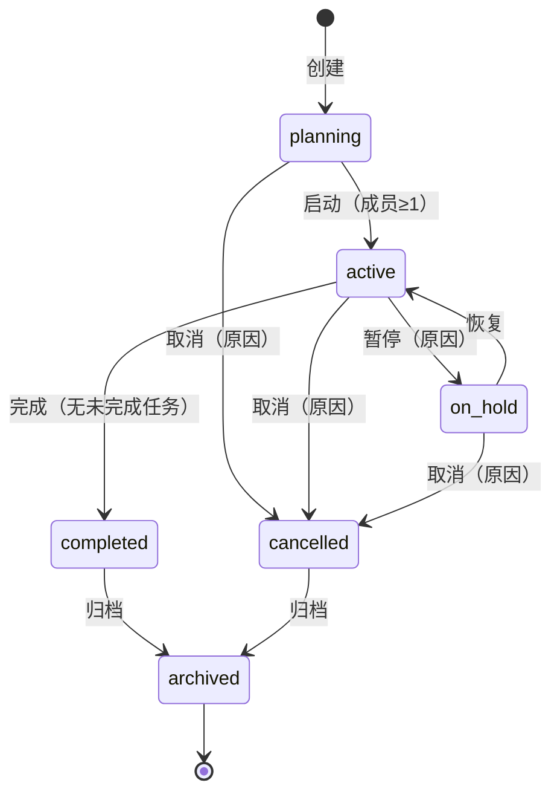
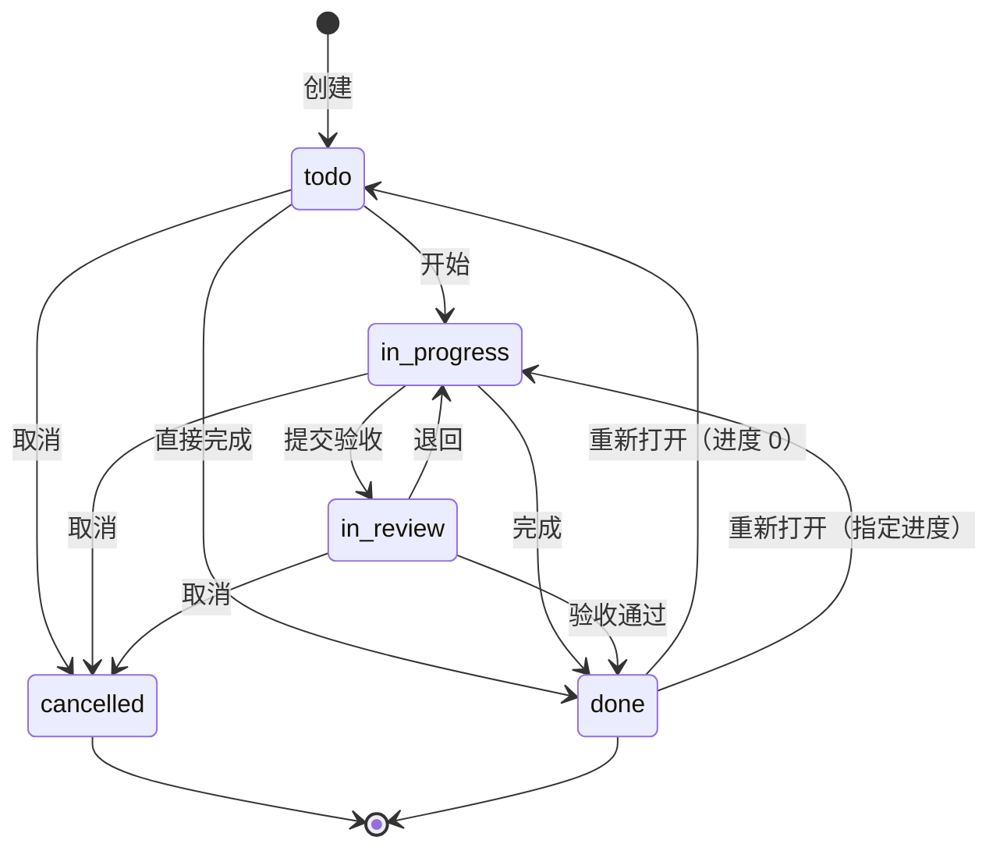

# 项目管理业务规则

> 文档状态：Draft for Review  
> 版本：0.1.0  
> 日期：2026-10-31  
> 关联：[产品需求](../01-product/product-requirements.md)、[业务流程](business-processes.md)、[数据存储设计](../03-technical/data-storage-design.md)

## 1. 范围

本文定义：

- 项目生命周期、成员、可见性；
- 任务状态机、进度、编号、看板排序、评论；
- 项目/任务权限矩阵与审计事件；
- 边界与异常规则。

不包含：任务依赖、甘特图、工时、冲刺、OKR、项目模板（均为 P2）。

## 2. 核心概念

| 概念 | 规则 |
|---|---|
| 项目 | 必须有名称、短键、owner、可见性、状态 |
| 短键 | `^[A-Z][A-Z0-9]{1,9}$`，组织内永久唯一（包含已软删除项目），创建后不可修改 |
| 任务编号 | `短键-序号`，序号为项目内正整数，删除不复用 |
| 项目成员 | 必须是同组织 active 用户；有且仅有 1 个 owner |
| 项目可见性 | `private`：仅成员；`organization`：组织成员可读，非成员只读 |
| 项目归档 | 只读终态，不是删除；默认列表隐藏 |
| 任务 | 必须属于一个未删除项目；标题必填；状态/进度强一致 |
| 看板 | 固定四列；取消任务不展示 |

## 3. 项目生命周期



### 3.1 迁移矩阵

| 当前 | 目标 | 允许 | 条件 | 权限 |
|---|---|---|---|---|
| planning | active | ✅ | 至少 1 名成员（owner 已满足） | owner/manager |
| planning | cancelled | ✅ | 原因 2–500 字 | owner/org_admin |
| active | on_hold | ✅ | 原因 2–500 字 | owner/manager |
| on_hold | active | ✅ | — | owner/manager |
| active | completed | ✅ | 无 todo/in_progress/in_review 任务 | owner/manager |
| active | cancelled | ✅ | 原因；可选同时取消未完成任务 | owner/org_admin |
| on_hold | cancelled | ✅ | 同 active | owner/org_admin |
| completed | archived | ✅ | — | owner/org_admin |
| cancelled | archived | ✅ | — | owner/org_admin |
| archived | * | ❌ | 终态 | — |
| 其他 | * | ❌ | 409 | — |

规则：

1. 任何状态变更必须携带 `version`，并发冲突 409。
2. 进入 `completed` 前统计未完成任务；返回 409 时带数量，不自动取消。
3. `cancelled` 时若 `cancel_open_tasks=true`，在同一事务把未完成任务置 `cancelled`，并写审计；否则保留任务但项目只读，需先处理。
4. `archived` 后项目、成员、任务、评论全部只读；文档只读；审批不受影响。
5. 归档不可逆（R1）；如误归档，由管理员通过受控运维恢复，不在 UI 提供。
6. 删除项目仅组织管理员，且必须无未完成任务；软删除，默认不可见；不提供恢复 UI。

### 3.2 可见性

| 项目可见性 | 成员 | 组织内非成员 | 外组织 |
|---|---|---|---|
| private | 读/写（按角色） | ❌ 404 | ❌ 404 |
| organization | 读/写（按角色） | 只读 | ❌ 404 |

- 非成员只读不能评论、不能看成员联系方式（仅姓名/部门/项目角色）。
- 改为 private 时，非成员立即失去访问；已打开页面下次请求 404。
- 管理员、`project:read:all` 和数据范围不能绕过私有项目成员限制；非成员的具体资源请求返回 404。
- 组织可见项目的任务列表可被非成员读取，但“我的待办”只基于分配关系。

### 3.3 owner 转让

1. 只有当前 owner 或 org_admin 可发起。
2. 新 owner 必须是项目成员且 active；可先添加。
3. 事务内：新 owner 的 `project_role=owner`，旧 owner 变为 `manager`，`projects.owner_id` 更新。
4. 旧 owner 不能在自己仍是 owner 时被移除；转让后方可退出。
5. 每次转让写审计并通知双方。

## 4. 项目成员

### 4.1 角色能力

| 能力 | owner | manager | member | viewer |
|---|---|---|---|---|
| 查看项目/任务 | ✅ | ✅ | ✅ | ✅ |
| 编辑项目基本信息 | ✅ | ✅ | ❌ | ❌ |
| 管理成员 | ✅ | ✅（不能动 owner/其他 manager） | ❌ | ❌ |
| 转让 owner | ✅ | ❌ | ❌ | ❌ |
| 归档项目 | ✅ | ❌ | ❌ | ❌ |
| 创建任务 | ✅ | ✅ | ✅ | ❌ |
| 编辑任意任务 | ✅ | ✅ | ❌ | ❌ |
| 分配/改期 | ✅ | ✅ | ❌ | ❌ |
| 删除任务 | ✅ | ✅ | ❌ | ❌ |
| 评论 | ✅ | ✅ | ✅ | ❌ |
| 上传文档到项目 | ✅ | ✅ | ✅ | ❌ |

### 4.2 添加/移除

- 添加：同组织 active 用户；重复添加幂等；单次最多 20 人。
- 移除：
  - 不能移除 owner。
  - manager 不能移除其他 manager/owner。
  - 若成员有未完成任务（todo/in_progress/in_review），返回 409 并列出数量；必须先转派或取消。
  - 移除后其评论/历史保留，显示姓名。
- 停用用户：自动失去访问；若仍是 owner 或当前审批人，停用操作被阻止，先转让/转交。
- 项目成员不因部门变更自动移除；由 PM 复核。

## 5. 任务

### 5.1 状态机



规则：

1. `cancelled` 是终态；不能恢复到其他状态。
2. `done` 可重新打开：owner/manager 或被分配者可操作；必须显式给 0–99 的进度（默认 0），`completed_at` 清空，写审计。
3. `todo → done` 允许（小任务直接完成），但需要更新权限。
4. `in_review` 的退回由 owner/manager 或被分配者执行；退回后状态 `in_progress`。
5. 任何状态变更需 `version`；并发 409。
6. 看板拖拽与 API 更新走同一状态机，不允许绕过。

### 5.2 进度一致性

| 状态 | 允许进度 | 规则 |
|---|---|---|
| todo | 0–99 | 默认 0 |
| in_progress | 0–99 | 默认 0；可任意调整 |
| in_review | 1–99 | 不能 0（已提交验收） |
| done | 100 | 强制 100 |
| cancelled | 0–100 | 保留取消时进度，不再变化 |

- 设置进度 100 时，必须同一请求置 `done`；否则 422。
- 置 `done` 时，服务端强制 `progress=100`、`completed_at=now()`。
- 从 done 重新打开：必须显式提交 0–99；未提交默认 0。
- 进度为整数，不接受小数。

### 5.3 任务编号

- 项目文档维护 `taskSeq`，创建任务时在事务内 `taskSeq = taskSeq + 1`，取新值作为 `taskNo`。
- 唯一索引 `projectId + taskNo` 兜底。
- 展示 `taskKey = project.key + "-" + taskNo`。
- 删除任务不回收编号；项目短键不可改，保证历史编号稳定。
- 并发创建：使用 `UPDATE ... RETURNING` 或事务内行锁，禁止先查后加。

### 5.4 看板排序

- 固定列：`todo`、`in_progress`、`in_review`、`done`。
- `board_order` 为整数，按列内升序；相同值按 `created_at`、`id` 兜底。
- **重排策略**：每次移动后，在事务内把目标列（及源列，如跨列）按新顺序重编号为 `1024, 2048, 3072...`。500 任务以内可接受；避免分数排序的精度耗尽与复杂重平衡。
- 移动请求：`task_id`、`target_status`、`target_index`、`version`。
- 跨列移动同时改变状态；必须满足状态机与进度规则。
- 筛选视图下拖拽：目标位置按“筛选结果内的相邻任务”计算，但重排作用于完整列；返回最新列数据。
- 并发：版本冲突 409；前端刷新该任务/列。

### 5.5 字段与权限

| 字段 | 创建 | 编辑权限 |
|---|---|---|
| 标题 | 必填 2–120 | 创建者、owner/manager |
| 描述 | 可选 ≤10000 Markdown | 创建者、owner/manager |
| 状态 | 默认 todo | 创建者/被分配者（合法迁移）、owner/manager |
| 优先级 | 默认 medium | 创建者、owner/manager |
| 负责人 | 可选，项目成员 | owner/manager |
| 开始/截止日期 | 可选 | 创建者、owner/manager；截止不得早于开始 |
| 进度 | 默认 0 | 创建者/被分配者、owner/manager |
| 删除 | — | owner/manager |

补充：

- 被分配者可以更新状态/进度，但不能改标题/描述/负责人/日期。
- 创建者可以改标题/描述/优先级/日期，但不能改负责人（除非也是 PM）。
- 非成员（组织可见项目）只读。
- viewer 只读。
- 任务负责人为空时，创建者/PM 可推进状态；允许进入 `in_review`，但项目概览标记“未分配”；首版不强制必须有人负责。

### 5.6 截止日期与逾期

- 截止日期为纯日期（组织时区），当天 23:59:59 前不算逾期。
- 逾期 = 未完成（todo/in_progress/in_review）且 `due_date < 今天`。
- 无截止日期不参与逾期统计。
- 项目健康度：完成率、逾期数、7 天内到期数。

### 5.7 完成任务与项目完成率

```text
有效任务 = 总任务 - cancelled
完成率 = done / 有效任务（有效任务为 0 时显示 0）
```

- 软删除任务不计入任何统计。
- 项目完成条件：无 todo/in_progress/in_review；cancelled 不计为未完成。
- 完成率只用于展示，不作为权限或状态迁移的唯一依据。

### 5.8 任务删除

- 软删除，仅 owner/manager；二次确认。
- 删除后：列表/看板/搜索/工作台消失；评论保留但不可访问；审计保留。
- 编号不复用。
- 首版无子任务，删除只影响当前任务；评论与审计保留。
- 删除任务不影响项目完成率分母（已排除）。

## 6. 评论

| 规则 | 说明 |
|---|---|
| 内容 | 1–2000 字，Markdown；禁止原始 HTML |
| 创建 | 项目成员（非 viewer） |
| 编辑 | 作者，发布后 15 分钟内 |
| 删除 | 作者；owner/manager/org_admin 可删除任意，需原因 |
| 展示 | 时间正序，分页 20；删除显示“评论已删除” |
| 通知 | 通知任务负责人/创建者（不含操作者自己） |
| 审计 | 创建/编辑/删除均记录；内容摘要脱敏 |

## 7. 权限与数据范围

### 7.1 项目读取

允许：

1. 拥有相应读取权限的项目成员；
2. 项目 `visibility=organization` 时拥有相应读取权限的同组织非成员（只读）。

禁止：其他组织、停用用户、私有项目非成员；组织管理员及 `project:read:all` 也不能绕过私有项目成员限制。

### 7.2 任务读取

与项目读取一致；任务软删除后仅审计可见。

### 7.3 写权限

所有写操作先校验项目成员身份及相应权限；组织可见项目非成员只读。

- 项目基本信息：owner/manager/org_admin。
- 成员：owner/manager（受层级限制）/org_admin。
- 任务：见 5.5。
- 评论：见第 6 节。
- 归档/取消/删除项目：owner/org_admin（删除仅 org_admin）。

## 8. 审计事件

| 事件 | 关键字段 |
|---|---|
| `project.created` | projectId、key、visibility |
| `project.updated` | 变更字段（脱敏） |
| `project.status_changed` | from、to、reason |
| `project.member_added/removed` | user_id、role |
| `project.owner_transferred` | from、to |
| `project.archived` | projectId |
| `task.created` | task_id、key、assignee |
| `task.updated` | 变更字段 |
| `task.status_changed` | from、to、progress |
| `task.deleted` | task_id、reason |
| `task.comment_created/updated/deleted` | comment_id、task_id |

所有事件含 actor、org、request_id、IP/UA、结果。

## 9. 边界与异常

| 场景 | 规则 |
|---|---|
| 项目短键冲突 | 409，提示更换；不自动加后缀 |
| owner 离职 | 先转让；未转让禁止停用 |
| 成员移除时有未完成任务 | 409 + 数量；先转派/取消 |
| 项目归档后写任务 | 409 `PROJECT_ARCHIVED` |
| 非成员访问私有项目 | 404 |
| 组织可见项目非成员写 | 403 |
| 任务并发更新 | 409 + 最新版本 |
| 任务删除后访问 | 404（审计可查） |
| 看板拖拽非法迁移 | 409，UI 回滚 |
| 项目完成时仍有未完成任务 | 409 + 数量 |
| 归档项目恢复 | R1 不支持；受控运维 |
| 短键修改 | 禁止；避免历史编号失效 |

## 10. 业务不变量

1. 每个项目有且仅有 1 个 owner，且 owner 必须是成员。
2. 任务编号在项目内唯一且不复用。
3. `done` ⇔ `progress=100`（cancelled 除外）。
4. 未完成任务不能出现在 `completed/archived` 项目中。
5. 归档项目不可写。
6. 私有项目数据不能被非成员读取。
7. 所有写操作有审计。
8. 删除是软删除，审批/审计不受影响。

## 11. 测试要点

- 项目状态机全路径（合法/非法）。
- owner 转让/移除/停用保护。
- 成员移除时未完成任务校验。
- 任务编号并发（100 并发创建）。
- 看板排序并发/跨列/筛选视图。
- 进度/状态组合边界（0/99/100）。
- 项目完成率口径。
- 私有/组织可见/归档/删除的读取矩阵。
- 评论 15 分钟边界（可注入时钟）。
- 审计事件完整性。


