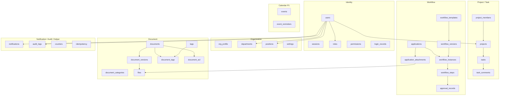
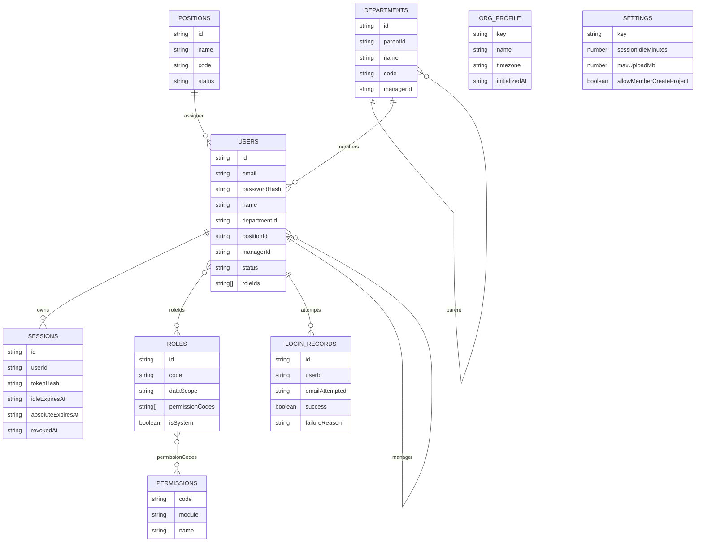
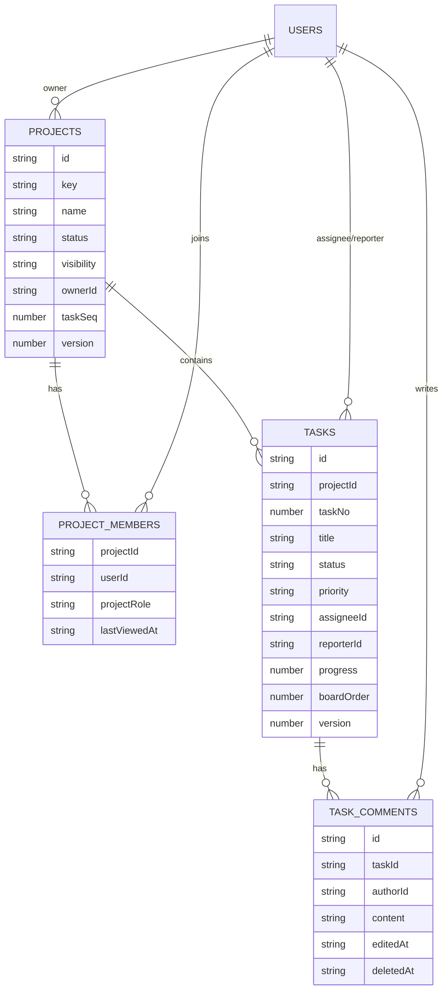
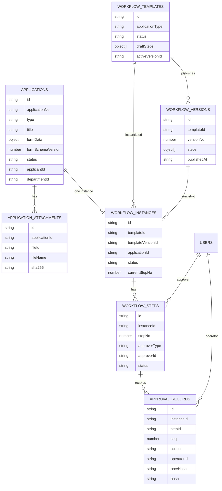
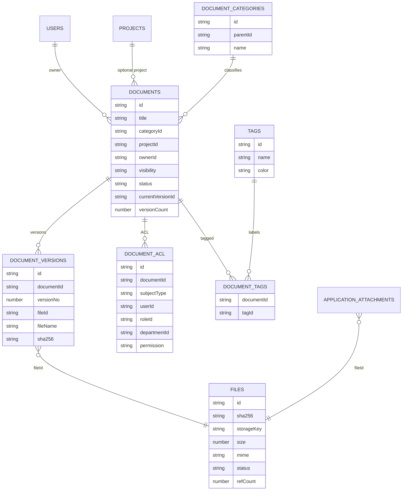
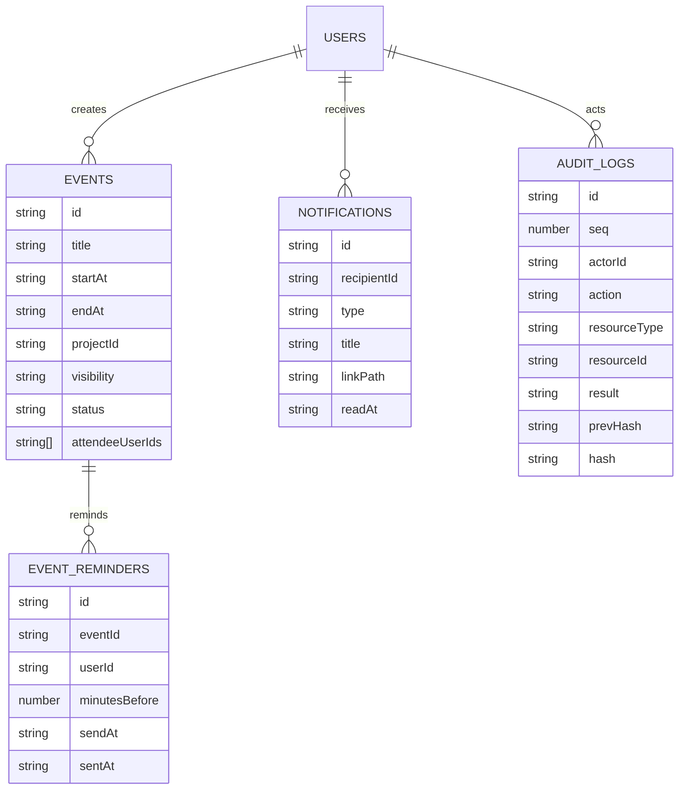

# 数据模型与引用关系图

> 文档状态：Draft for Review  
> 版本：0.2.0  
> 日期：2026-10-31  
> 说明：本文替代 SQL ER 图；不是数据库表结构，而是**业务实体、JSON 文档、引用关系、KV 键空间**。  
> 配套：[数据存储设计](data-storage-design.md)

## 1. 总览

> 箭头表示“引用/归属”，不是 SQL 外键；引用完整性由服务层 + 索引校验保证。

## 2. Identity 与 Organization

关系规则：

- 单组织；不存在 `organizationId`/组织切换。
- 一个用户一个主部门、一个岗位、一个直属上级。
- 用户 `roleIds` 直接内嵌；角色 `permissionCodes` 内嵌；不再单独建 user_roles/role_permissions。
- 部门 parent 不能成环，最大深度 10。
- 用户删除用 `status=disabled`，不物理删除。

## 3. Project / Task

关系规则：

- `project_members` 主键为 `projectId\u001FuserId`。
- 每项目仅 1 个 owner；owner 转让需事务更新项目与成员。
- 任务 `projectId + taskNo` 唯一；`taskNo` 来自项目 `taskSeq`。
- 任务负责人必须为项目成员；可为空。
- 任务软删除不回收编号。

## 4. Workflow

关系规则：

- 一个申请最多一个实例；实例必须引用已发布模板版本。
- 步骤提交时解析审批人并快照；模板更新不影响进行中实例。
- 一个实例最多一个 active 步骤；一步最多一条 approve/reject；一实例最多一条 withdraw。
- 审批记录只追加，实例内哈希链；不覆盖历史。

## 5. Document / File

关系规则：

- `documents.currentVersionId` 指向最新版本；版本只追加。
- `files` 按 SHA-256 内容寻址；文档版本/申请附件通过 `fileId` 引用。
- 文件内容在本地文件系统；`files` 只存元数据。
- 文档 ACL 独立实体；owner 始终 manage；组织管理员绕过。
- 标签/ACL 变更与文档写入同一事务；文件删除延迟清理。

## 6. Calendar / Notification / Audit / Helper

补充：

- `events.attendees` 内嵌参与人及响应；`event_reminders` 单独存放调度。
- `audit_logs` 全局 seq + 哈希链；只追加。
- `counters` / `idempotency` 是辅助键空间，不属于业务实体图。

## 7. KV 键空间与主键

| 实体 | 子库 | 主键 | 复合键示例 |
|---|---|---|---|
| users | `users` | userId | — |
| sessions | `sessions` | sessionId | — |
| roles | `roles` | roleId | — |
| permissions | `permissions` | permissionCode | — |
| login_records | `login_records` | recordId | — |
| org_profile | `org_profile` | `profile` | — |
| departments | `departments` | departmentId | — |
| positions | `positions` | positionId | — |
| settings | `settings` | `settings` | — |
| projects | `projects` | projectId | — |
| project_members | `project_members` | projectId + userId | `p1\u001Fu1` |
| tasks | `tasks` | taskId | — |
| task_comments | `task_comments` | commentId | — |
| applications | `applications` | applicationId | — |
| application_attachments | `application_attachments` | attachmentId | — |
| workflow_templates | `workflow_templates` | templateId | — |
| workflow_versions | `workflow_versions` | versionId | — |
| workflow_instances | `workflow_instances` | instanceId | — |
| workflow_steps | `workflow_steps` | stepId | — |
| approval_records | `approval_records` | recordId | — |
| documents | `documents` | documentId | — |
| document_versions | `document_versions` | versionId | — |
| document_categories | `document_categories` | categoryId | — |
| tags | `tags` | tagId | — |
| document_tags | `document_tags` | documentId + tagId | `d1\u001Ft1` |
| document_acl | `document_acl` | aclId | — |
| files | `files` | fileId | — |
| events | `events` | eventId | — |
| event_reminders | `event_reminders` | reminderId | — |
| notifications | `notifications` | notificationId | — |
| audit_logs | `audit_logs` | seq + recordId | `000000000123\u001Fa1` |
| counters | `counters` | scope + period | `application\u001F20261103` |
| idempotency | `idempotency` | userId + key | `u1\u001Fabc` |

## 8. 引用与删除规则

| 引用 | 规则 |
|---|---|
| user.departmentId → departments | 部门删除前必须无员工；用户部门必须 active |
| user.positionId → positions | 岗位删除前检查引用 |
| user.managerId → users | 不能自引用/成环 |
| project.ownerId → users | owner 必须是项目成员；唯一 |
| project_members.userId → users | 停用用户不能新增；移除前检查未完成任务 |
| task.projectId → projects | 项目归档后任务只读 |
| task.assigneeId → users | 必须是项目成员 |
| application.applicantId → users | 提交后不变 |
| application_attachments.fileId → files | 删除附件软删；文件 refCount |
| workflow_instance.applicationId → applications | 一个申请最多一个实例 |
| workflow_step.approverId → users | 提交时快照；失效走转交 |
| approval_records.stepId → workflow_steps | 只追加；不删除 |
| document.categoryId → categories | 删除分类前检查文档 |
| document.projectId → projects | 项目文档继承项目可见性 |
| document_versions.fileId → files | 版本不可变 |
| document_acl.documentId → documents | 主体三选一；唯一 |
| events.projectId → projects | 项目归档后只读 |
| notifications.recipientId → users | 接收人 active |
| audit_logs.actorId → users | 可为空（系统） |

删除策略：

- 软删除：users（disabled）、departments、positions、projects、tasks、comments、documents、categories、tags、events。
- 只追加：approval_records、audit_logs、login_records、document_versions。
- 物理删除：draft applications、未引用临时文件、过期 sessions/notifications（维护任务）。
- 不做级联删除；服务层先检查引用，必要时阻止并提示。

## 9. 索引与查询映射

| 查询 | 键空间 |
|---|---|
| 登录 | `idx_users_email` |
| 我的待办 | `idx_tasks_assignee` |
| 项目看板 | `idx_tasks_project_status` |
| 待我审批 | `idx_steps_approver` |
| 我的申请 | `idx_applications_applicant` |
| 最近项目 | `idx_members_user` |
| 文档列表 | `idx_documents_updated` |
| 文档搜索 | `idx_documents_title` + ACL 过滤 |
| 通知 | `idx_notifications_recipient` |
| 审计 | `idx_audit_actor` / `idx_audit_resource` |

## 10. 数据模型验收

- [ ] 实体字段、类型、必填/可空、引用规则明确。
- [ ] 无 `organization_id`/多租户字段。
- [ ] 无 SQL 表/外键/ORM 类型。
- [ ] 每个高频查询有索引。
- [ ] 唯一约束通过索引键实现。
- [ ] 审批/审计只追加。
- [ ] 文件元数据与文件引用清晰。

