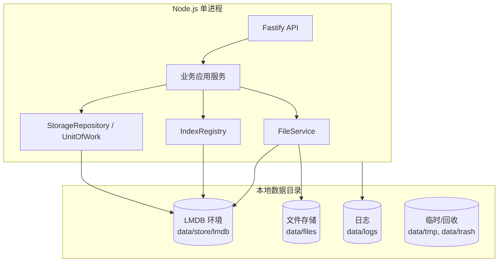

# 数据存储设计（嵌入式 KV）

> 文档状态：Draft for Review  
> 版本：0.2.0  
> 日期：2026-10-31  
> 存储引擎：**LMDB（`lmdb` 3.5.9，首选）**  
> 替代文档：`database-design.md`（SQL/Prisma 版，已废止）  
> 关联：[数据模型图](data-model-diagram.md)、[嵌入式存储评估](../05-research/embedded-storage-evaluation.md)、[系统架构](system-architecture.md)

## 1. 结论先行

1. 本项目**不使用 SQL 数据库、SQL ORM、独立数据库服务、Docker**。
2. 采用**单组织、单机、模块化单体 + 嵌入式 LMDB + 本地文件系统**。
3. 所有业务记录以 JSON 文档存入 LMDB 命名子库；索引是独立命名子库，可重建，不是数据源。
4. 所有写操作必须经过 `StorageRepository` / `UnitOfWork`，业务模块不得直接打开 LMDB 或访问 `data.mdb`。
5. 多记录关键写操作（申请提交、审批、任务编号、审计、文件元数据）必须在**同一 LMDB 写事务**内完成。
6. 审批记录、审计日志、登录记录只追加；不提供 UPDATE/DELETE API。
7. 文件与 KV 无法共享事务，采用“文件先落盘 + 元数据事务 + 失败补偿 + 启动对账”的协议。
8. 正式项目依赖尚未安装；存储选型以 [嵌入式存储评估](../05-research/embedded-storage-evaluation.md) 的原型结果为依据，待人工确认后固化。

## 2. 设计目标与边界

### 2.1 目标

- 单组织部署，无多租户、无组织切换、无 `organization_id`。
- Windows 本机优先；默认仅本机浏览器访问，局域网需显式配置。
- 不需要用户安装/维护独立数据库服务。
- 数据保存在本地数据目录，程序升级不破坏数据。
- 支持事务、并发读写、崩溃恢复、索引重建、数据校验。
- 保持原有业务领域与完整功能，不因存储改造缩减产品。
- 结构简单，可由单人 + AI 维护。

### 2.2 非目标

- 多节点/多主写入/分布式事务。
- 跨网络文件系统（SMB/NFS）共享数据目录。
- 在线水平扩展。
- 通用低代码/对象建模。
- SQL 兼容层。
- 首版数据加密（可选评估，不作为 R1 前提）。

## 3. 总体存储架构



层次：

1. 前端展示层（React SPA）。
2. API 接口层（Fastify）。
3. 身份认证/权限层。
4. 业务应用层（用例、事务、审计、通知）。
5. 领域业务层（状态机、审批、ACL、数据范围）。
6. 存储抽象层（Repository / UnitOfWork / StorageEngine）。
7. 嵌入式 KV 层（LMDB 命名子库）。
8. 本地文件系统层（附件/文档/日志）。
9. 日志、审计与运行监控层。

## 4. 本地目录布局

```text
EnterprisePlatform/
├─ app/
│  ├─ frontend/                 # 构建后的 SPA（dist）
│  ├─ backend/                  # Node/Fastify 构建产物
│  └─ shared/                   # 共享契约（构建产物/类型）
├─ data/
│  ├─ config/
│  │  └─ platform.json          # 非敏感配置（端口、时区、目录、限制）
│  ├─ store/
│  │  └─ lmdb/
│  │     ├─ data.mdb
│  │     └─ lock.mdb
│  ├─ files/
│  │  └─ <sha256 前 2 位>/<sha256>
│  ├─ logs/
│  │  ├─ app-YYYY-MM-DD.log
│  │  └─ audit-YYYY-MM-DD.jsonl（可选导出）
│  ├─ tmp/
│  ├─ trash/
│  └─ locks/
│     └─ app.lock               # 单实例锁
├─ scripts/
│  ├─ start.cmd
│  ├─ verify.mjs
│  └─ rebuild-indexes.mjs
└─ config.example.json
```

规则：

- `app/` 只读；`data/` 可写；普通 Windows 用户/进程运行，不使用服务账号/服务注册。
- `data/config` 与业务数据分离；敏感密钥用环境变量，不写入 `platform.json`。
- 附件/文档文件与 KV 元数据分离；文件按内容 SHA-256 寻址。
- `data/tmp` 用于上传临时文件；启动/定时清理超过 24h 的临时文件。
- `data/trash` 用于软删除文件的延迟清理；默认保留 7 天。
- **禁止**把 `data/` 放在 OneDrive、SMB/NFS 网络盘、压缩/加密容器或会被同步工具频繁改写的目录。
- 不设 `data/backups`；不实现自动备份、异地备份、备份保留/加密/恢复 UI。
- 普通用户/其他进程不得读取 `data/`；目录权限由 Windows ACL 控制。

## 5. LMDB 配置

```ts
open({
  path: dataDir + '/store/lmdb',
  encoding: 'json',
  maxDbs: 128,
  mapSize: 2 * 1024 * 1024 * 1024, // 2GB 虚拟地址预留，按容量调整
  // 不启用 encryptionKey / compression（R1）
  // 不启用 noSync / useWritemap
});
```

| 选项 | 值 | 理由 |
|---|---|---|
| `encoding` | `json` | 可读、可迁移、调试友好；50k 任务性能足够 |
| `maxDbs` | 128 | 实体库 + 索引库，预留增长 |
| `mapSize` | 2–4GB | 虚拟地址预留，不等于磁盘占用；目标数据量远小于此 |
| `overlappingSync` | Windows 默认关闭 | LMDB 文档建议 Windows 不启用 |
| `noSync` | 不启用 | 关键业务必须持久化 |
| `useWritemap` | 不启用 | 降低 stray pointer 损坏风险 |
| `encryptionKey` | R1 不启用 | 不实现应用层静态加密 |
| `compression` | R1 不启用 | 数据量可控；保持配置简单 |
| `maxReaders` | 默认 | 单进程读多写少 |

## 6. 存储抽象

### 6.1 接口

```ts
interface StorageEngine {
  open(): Promise<void>;
  close(): Promise<void>;
  transaction<T>(fn: (tx: StorageTransaction) => Promise<T> | T): Promise<T>;
  healthCheck(): Promise<{ ok: boolean; schemaVersion: number; writable: boolean }>;
}

interface StorageTransaction {
  get<T>(store: StoreName, key: string): T | undefined;
  put<T>(store: StoreName, key: string, value: T): void;
  remove(store: StoreName, key: string): void;
  range<T>(store: StoreName, options: RangeOptions): Iterable<{ key: string; value: T }>;
}

interface Repository<T> {
  get(id: string, tx?: StorageTransaction): T | undefined;
  put(doc: T, tx?: StorageTransaction): void;
  remove(id: string, tx?: StorageTransaction): void;
  list(query: Query, tx?: StorageTransaction): Page<T>;
}

interface UnitOfWork {
  run<T>(fn: (uow: UnitOfWorkContext) => Promise<T> | T): Promise<T>;
}
```

- 业务模块只依赖 `Repository` / `UnitOfWork`，不导入 `lmdb`。
- `LmdbStorageEngine` 是唯一实现；未来可替换为其他 KV/文档存储，但必须保持事务/索引语义。
- `StoreName`、`IndexName`、`SchemaRegistry` 由存储层统一维护；业务模块不得自行 `open()` 子库。
- 测试可注入临时目录的 `LmdbStorageEngine`，不 mock 存储引擎（除纯策略单测）。

### 6.2 仓储职责

| 层 | 职责 |
|---|---|
| `StorageEngine` | 打开/关闭 LMDB、事务、健康检查 |
| `Repository<T>` | 文档读写、按 ID 查询、分页、索引查询 |
| `IndexRegistry` | 索引定义、写入/删除索引、重建 |
| `UnitOfWork` | 跨仓储事务、提交/回滚、审计/通知 |
| 业务服务 | 权限、状态机、引用校验、调用 UnitOfWork |

## 7. 文档信封

所有实体文档统一信封：

```json
{
  "id": "0192f1c4-7d3a-7b2e-9a11-3c5d8e9f0a12",
  "type": "task",
  "schemaVersion": 1,
  "version": 7,
  "createdAt": "2026-10-31T10:00:00.000Z",
  "updatedAt": "2026-10-31T10:05:00.000Z",
  "deletedAt": null,
  "title": "示例业务字段"
}
```

业务字段平铺在顶层（更易读、便于索引），但必须保留以下系统字段：

- `id`：UUIDv7，业务主键；
- `type`：实体类型；
- `schemaVersion`：文档 schema 版本；
- `version`：乐观锁版本，每次写入 +1；
- `createdAt` / `updatedAt`：UTC ISO；
- `deletedAt`：软删除时间或 null。

**约定**：本文后续字段表只列业务字段，信封字段不再重复。

## 8. 命名子库（Keyspaces）

| 子库 | 内容 | 主键 |
|---|---|---|
| `meta` | schemaVersion、初始化标记、审计链尾、计数器版本、单实例信息 | 固定字符串 |
| `users` | 用户账号 + 雇佣属性 + roleIds | userId |
| `sessions` | 会话 | sessionId |
| `roles` | 角色 + permissionCodes | roleId |
| `permissions` | 权限目录（seed，只读） | permissionCode |
| `login_records` | 登录尝试 | recordId |
| `org_profile` | 组织单例 | `profile` |
| `departments` | 部门树 | departmentId |
| `positions` | 岗位 | positionId |
| `settings` | 系统配置单例 | `settings` |
| `projects` | 项目 | projectId |
| `project_members` | 项目成员 | `projectId\u001FuserId` |
| `tasks` | 任务 | taskId |
| `task_comments` | 评论 | commentId |
| `applications` | 申请 | applicationId |
| `application_attachments` | 申请附件 | attachmentId |
| `workflow_templates` | 审批模板 | templateId |
| `workflow_versions` | 模板版本 | versionId |
| `workflow_instances` | 审批实例 | instanceId |
| `workflow_steps` | 审批步骤 | stepId |
| `approval_records` | 审批记录（追加） | recordId |
| `documents` | 文档 | documentId |
| `document_versions` | 文档版本 | versionId |
| `document_categories` | 文档分类 | categoryId |
| `tags` | 标签 | tagId |
| `document_tags` | 文档-标签关系 | `documentId\u001FtagId` |
| `document_acl` | 文档 ACL | aclId |
| `files` | 文件内容元数据 | fileId |
| `events` | 日程（P1） | eventId |
| `event_reminders` | 提醒（P1） | reminderId |
| `notifications` | 站内通知 | notificationId |
| `audit_logs` | 操作审计 | `seq\u001FrecordId` |
| `counters` | 业务序号 | `scope\u001Fperiod` |
| `idempotency` | 幂等键 | `userId\u001Fkey` |

索引子库统一以 `idx_` 开头，例如 `idx_users_email`、`idx_tasks_project_status`。  
`maxDbs` 必须覆盖实体库 + 索引库 + 余量；当前设计约 40 个命名库，128 足够。

## 9. 键编码

- 单实体：`id`（UUIDv7）。
- 复合键/索引：`joinKey(parts)`，使用 ASCII Unit Separator `\u001F` 分隔。
- 所有文本字段拒绝控制字符 `\u0000`–`\u001F`（换行除外，按字段单独允许）；从输入层 Zod 校验。
- 数字索引：零填充 12 位（如 `000000001024`）。
- 日期索引：UTC ISO 字符串（可按字典序排序）。
- 前缀范围：`start = prefix + '\u001F'`，`end = prefix + '\u001F\uffff'`。
- 禁止用用户输入直接拼接键；必须经 `KeyCodec`。
- 键长度远小于 LMDB 限制（默认约 1978 字节）；标题/正文不进入键。

示例：

```ts
joinKey('task', projectId, status, pad12(boardOrder), taskId)
// "task\u001Fp_123\u001Fin_progress\u001F000000001024\u001Ft_456"
```

## 10. 实体定义

> 字段为逻辑类型；`?` 可空；`[]` 数组；`ref:` 引用其他实体 ID；`enum` 为受控字符串。  
> 所有实体都含第 7 节信封字段。所有时间存 UTC ISO 字符串。

### 10.1 Identity

#### users

| 字段 | 类型 | 规则 |
|---|---|---|
| `email` | string | 小写、trim；唯一 |
| `passwordHash` | string | Argon2id |
| `name` | string | 2–80 |
| `avatarFileId` | string? | ref: files |
| `phone` | string? | 可选 |
| `employeeNo` | string? | 唯一（非空时） |
| `departmentId` | string? | ref: departments |
| `positionId` | string? | ref: positions |
| `managerId` | string? | ref: users；不能自引用/成环 |
| `status` | enum | `active`, `disabled` |
| `mustChangePassword` | boolean | 首次登录 |
| `passwordChangedAt` | string? | — |
| `failedLoginCount` | number | ≥0 |
| `lockedUntil` | string? | — |
| `lastLoginAt` | string? | — |
| `roleIds` | string[] | ref: roles；至少 1 个 |

引用规则：部门/岗位/上级必须存在且 active；删除部门/岗位前检查引用；角色删除前检查持有者。

#### sessions

| 字段 | 类型 | 规则 |
|---|---|---|
| `userId` | string | ref: users |
| `tokenHash` | string | SHA-256；唯一 |
| `ip` | string? | — |
| `userAgent` | string? | — |
| `lastSeenAt` | string | — |
| `idleExpiresAt` | string | — |
| `absoluteExpiresAt` | string | — |
| `revokedAt` | string? | — |
| `revokeReason` | string? | logout/password_change/admin/disabled |

#### roles

| 字段 | 类型 | 规则 |
|---|---|---|
| `code` | string | 唯一；内置 `member/org_admin/system_admin/auditor` |
| `name` | string | 2–30 |
| `description` | string? | ≤300 |
| `dataScope` | enum | `self`, `department`, `department_tree`, `all` |
| `isSystem` | boolean | 内置不可改 |
| `permissionCodes` | string[] | ref: permissions；默认拒绝 |

内置角色权限在 seed 中固定；自定义角色权限在角色文档内，更新角色即生效。

#### permissions（静态目录）

| 字段 | 类型 | 规则 |
|---|---|---|
| `code` | string | 主键，`resource:action` |
| `module` | string | 分组 |
| `name` | string | 中文名 |
| `description` | string? | — |

只读；由代码 seed，UI 不可新增。

#### login_records

| 字段 | 类型 | 规则 |
|---|---|---|
| `userId` | string? | 未知邮箱为空 |
| `emailAttempted` | string | 小写 |
| `success` | boolean | — |
| `failureReason` | string? | invalid_credentials/disabled/locked/unknown |
| `ip` | string? | — |
| `userAgent` | string? | — |

只追加。

### 10.2 Organization

#### org_profile（单例）

| 字段 | 类型 | 规则 |
|---|---|---|
| `name` | string | 2–80 |
| `timezone` | string | IANA，默认 Asia/Shanghai |
| `locale` | string | 默认 zh-CN |
| `initializedAt` | string | — |

键固定 `profile`；不存在时应用进入初始化向导，不自动创建默认管理员。

#### departments

| 字段 | 类型 | 规则 |
|---|---|---|
| `parentId` | string? | ref: departments；不能自引用/成环 |
| `name` | string | 同父级唯一 |
| `code` | string? | 唯一（非空时） |
| `managerId` | string? | ref: users |
| `description` | string? | ≤300 |
| `sortOrder` | number | ≥0 |

最大深度 10；删除前检查子部门/员工/引用。

#### positions

| 字段 | 类型 | 规则 |
|---|---|---|
| `name` | string | 唯一 |
| `code` | string | 唯一 |
| `description` | string? | — |
| `sortOrder` | number | — |
| `status` | enum | `active`, `inactive` |

#### settings（单例）

| 字段 | 类型 | 规则 |
|---|---|---|
| `sessionIdleMinutes` | number | 15–1440 |
| `sessionAbsoluteDays` | number | 1–30 |
| `maxUploadMb` | number | 1–100 |
| `defaultProjectVisibility` | enum | private/all |
| `allowMemberCreateProject` | boolean | 默认 true |
| `logRetentionDays` | number | 7–365 |


键固定 `settings`；仅白名单字段；变更写审计。

### 10.3 Project / Task

#### projects

| 字段 | 类型 | 规则 |
|---|---|---|
| `key` | string | `^[A-Z][A-Z0-9]{1,9}$`；唯一；创建后不可改 |
| `name` | string | 2–80 |
| `description` | string? | Markdown ≤10k |
| `status` | enum | planning/active/on_hold/completed/cancelled/archived |
| `visibility` | enum | private/organization |
| `ownerId` | string | ref: users；唯一 owner |
| `startDate` / `dueDate` | string? | `YYYY-MM-DD`；due ≥ start |
| `taskSeq` | number | 任务序号计数器 |
| `completedAt` / `archivedAt` | string? | — |

#### project_members

复合键 `projectId\u001FuserId`。

| 字段 | 类型 | 规则 |
|---|---|---|
| `projectId` | string | ref: projects |
| `userId` | string | ref: users |
| `projectRole` | enum | owner/manager/member/viewer |
| `addedBy` | string? | ref: users |
| `joinedAt` | string | — |
| `lastViewedAt` | string? | — |

每项目仅 1 个 owner（唯一索引）；owner 不可直接移除。

#### tasks

| 字段 | 类型 | 规则 |
|---|---|---|
| `projectId` | string | ref: projects |
| `taskNo` | number | 项目内唯一；来自 taskSeq |
| `title` | string | 2–120 |
| `description` | string? | Markdown ≤10k |
| `status` | enum | todo/in_progress/in_review/done/cancelled |
| `priority` | enum | low/medium/high/urgent |
| `assigneeId` | string? | ref: users；必须是项目成员 |
| `reporterId` | string | ref: users |
| `startDate` / `dueDate` | string? | due ≥ start |
| `completedAt` | string? | — |
| `progress` | number | 0–100；done ⇔ 100 |
| `boardOrder` | number | 列内排序 |
| `deletedAt` | string? | 软删除 |

#### task_comments

| 字段 | 类型 | 规则 |
|---|---|---|
| `taskId` | string | ref: tasks |
| `authorId` | string | ref: users |
| `content` | string | 1–2000 |
| `editedAt` | string? | — |
| `deletedAt` | string? | — |

### 10.4 Workflow

#### applications

| 字段 | 类型 | 规则 |
|---|---|---|
| `applicationNo` | string? | 提交时分配，唯一；草稿为空 |
| `type` | enum | leave/travel/field/seal/general |
| `title` | string | 2–100 |
| `formSchemaVersion` | number | — |
| `formData` | object | 按类型 Zod 校验 |
| `startAt` / `endAt` | string? | end > start |
| `status` | enum | draft/pending/approved/rejected/withdrawn |
| `applicantId` | string | ref: users |
| `departmentId` | string? | 提交时快照 |
| `submittedAt` / `completedAt` | string? | — |

#### application_attachments

| 字段 | 类型 | 规则 |
|---|---|---|
| `applicationId` | string | ref: applications |
| `fileId` | string | ref: files |
| `fileName` | string | 展示名 |
| `mime` | string | — |
| `size` | number | >0 |
| `sha256` | string | 64 hex |
| `uploadedBy` | string | ref: users |
| `deletedAt` | string? | — |

#### workflow_templates

| 字段 | 类型 | 规则 |
|---|---|---|
| `name` | string | 2–50 |
| `applicationType` | enum | 五类 |
| `status` | enum | draft/active/inactive |
| `draftSteps` | object[] | 1–10 步 |
| `activeVersionId` | string? | ref: workflow_versions |

同类型最多 1 个 active（唯一索引）。

#### workflow_versions

| 字段 | 类型 | 规则 |
|---|---|---|
| `templateId` | string | ref: workflow_templates |
| `versionNo` | number | 模板内唯一 |
| `steps` | object[] | 不可变快照 |
| `createdBy` | string | ref: users |
| `publishedAt` | string | — |

#### workflow_instances

| 字段 | 类型 | 规则 |
|---|---|---|
| `templateId` | string | ref: workflow_templates |
| `templateVersionId` | string | ref: workflow_versions |
| `applicationId` | string | ref: applications；唯一 |
| `status` | enum | running/approved/rejected/withdrawn |
| `currentStepNo` | number | ≥1 |
| `startedAt` / `completedAt` | string? | — |

#### workflow_steps

| 字段 | 类型 | 规则 |
|---|---|---|
| `instanceId` | string | ref: workflow_instances |
| `stepNo` | number | 实例内唯一 |
| `name` | string | 1–50 |
| `approverType` | enum | user/department_manager/direct_manager |
| `approverId` | string | ref: users；解析后快照 |
| `status` | enum | waiting/active/approved/rejected/cancelled |
| `activatedAt` / `completedAt` | string? | — |

一个实例最多 1 个 active 步骤（唯一索引）。

#### approval_records（追加）

| 字段 | 类型 | 规则 |
|---|---|---|
| `instanceId` | string | ref: workflow_instances |
| `applicationId` | string | ref: applications |
| `stepId` | string | ref: workflow_steps |
| `seq` | number | 实例内递增 |
| `action` | enum | approve/reject/withdraw/reassign |
| `operatorId` | string | ref: users |
| `comment` | string? | ≤500 |
| `metadata` | object | 转交 from/to/reason |
| `prevHash` / `hash` | string | 实例内哈希链 |
| `createdAt` | string | — |

只追加；不提供更新/删除；每步最多一条 approve/reject（唯一索引），每实例最多一条 withdraw。

### 10.5 Document

#### documents

| 字段 | 类型 | 规则 |
|---|---|---|
| `title` | string | 2–100 |
| `description` | string? | ≤1000 |
| `categoryId` | string? | ref: document_categories |
| `projectId` | string? | ref: projects |
| `ownerId` | string | ref: users |
| `visibility` | enum | organization/project/restricted |
| `status` | enum | active/archived |
| `currentVersionId` | string? | ref: document_versions |
| `versionCount` | number | ≥0 |

#### document_versions

| 字段 | 类型 | 规则 |
|---|---|---|
| `documentId` | string | ref: documents |
| `versionNo` | number | 文档内唯一 |
| `fileId` | string | ref: files |
| `fileName` | string | 展示名 |
| `mime` | string | — |
| `size` | number | >0 |
| `sha256` | string | 64 hex |
| `versionNote` | string? | ≤200 |
| `uploadedBy` | string | ref: users |

不可变；不删除。

#### document_categories

| 字段 | 类型 | 规则 |
|---|---|---|
| `parentId` | string? | ref: document_categories |
| `name` | string | 同父级唯一 |
| `sortOrder` | number | — |

最大深度 5；删除前检查子分类/文档。

#### tags

| 字段 | 类型 | 规则 |
|---|---|---|
| `name` | string | 1–20；组织内不区分大小写唯一 |
| `color` | string | 预设色 |

#### document_tags

复合键 `documentId\u001FtagId`；字段 documentId、tagId、createdAt。

#### document_acl

| 字段 | 类型 | 规则 |
|---|---|---|
| `documentId` | string | ref: documents |
| `subjectType` | enum | user/role/department |
| `userId` / `roleId` / `departmentId` | string? | 三选一 |
| `permission` | enum | view/edit/manage |
| `includeDescendants` | boolean | 部门用 |
| `createdBy` | string | ref: users |

同一文档 + 同一主体唯一；owner 始终 manage；组织管理员绕过。

#### files

| 字段 | 类型 | 规则 |
|---|---|---|
| `sha256` | string | 唯一；内容寻址 |
| `storageKey` | string | `<sha256前2位>/<sha256>` |
| `size` | number | >0 |
| `mime` | string | — |
| `status` | enum | pending/active/missing/deleted |
| `refCount` | number | 逻辑引用计数，事务维护 |
| `createdAt` / `deletedAt` | string? | — |

文件内容本身在 `data/files`；`files` 只存元数据。

### 10.6 Calendar / Notification / Audit

#### events（P1）

| 字段 | 类型 | 规则 |
|---|---|---|
| `title` | string | 2–120 |
| `description` | string? | Markdown |
| `startAt` / `endAt` | string | end > start |
| `allDay` | boolean | — |
| `timezone` | string | IANA |
| `location` | string? | ≤200 |
| `projectId` | string? | ref: projects |
| `createdBy` | string | ref: users |
| `visibility` | enum | private/project/organization |
| `status` | enum | confirmed/cancelled |
| `attendees` | array | `{userId,responseStatus,respondedAt}` |

#### event_reminders（P1）

| 字段 | 类型 | 规则 |
|---|---|---|
| `eventId` | string | ref: events |
| `userId` | string | ref: users |
| `minutesBefore` | number | 5/15/30/60 |
| `sendAt` | string | — |
| `sentAt` | string? | — |

#### notifications

| 字段 | 类型 | 规则 |
|---|---|---|
| `recipientId` | string | ref: users |
| `type` | enum | task_assigned/approval_requested/approval_result/project_member/document_shared/system |
| `title` | string | ≤120 |
| `content` | string? | ≤500 |
| `linkPath` | string? | 相对路径 |
| `readAt` | string? | — |

#### audit_logs（追加）

| 字段 | 类型 | 规则 |
|---|---|---|
| `seq` | number | 全局递增 |
| `actorId` | string? | 系统操作为空 |
| `action` | string | 如 `task.updated` |
| `resourceType` | string | — |
| `resourceId` | string? | — |
| `result` | enum | success/failure |
| `ip` / `userAgent` / `requestId` | string? | — |
| `metadata` | object | 脱敏摘要 |
| `prevHash` / `hash` | string | 全局审计哈希链 |
| `createdAt` | string | — |

只追加；不提供修改/删除。

### 10.7 辅助

#### counters

复合键 `scope\u001Fperiod`；字段 `value`。用于 applicationNo、审批记录 seq、审计 seq 等。  
项目任务序号使用 `projects.taskSeq`，在项目文档同一事务内递增。

#### idempotency

复合键 `userId\u001Fkey`；字段 `requestHash`、`responseStatus`、`responseBody`、`resourceType`、`resourceId`、`createdAt`、`expiresAt`。

## 11. 索引设计

### 11.1 索引规则

- 每个实体库可有 0..N 个索引子库。
- 索引键 -> 实体 ID；唯一索引用于唯一约束。
- 非唯一索引键末尾附实体 ID，保证唯一键、可稳定排序。
- 写入文档时在同一事务内更新索引；删除/软删除时移除索引。
- 索引损坏/丢失可重建；不得把索引当唯一数据源。
- 重建索引必须在维护模式下进行，完成后校验计数与样本。

### 11.2 主要索引

| 实体 | 索引 | 键 | 唯一 | 用途 |
|---|---|---|---|---|
| users | `idx_users_email` | email | ✅ | 登录/唯一 |
| users | `idx_users_department` | departmentId\u001Fstatus\u001FuserId | ❌ | 部门成员 |
| users | `idx_users_manager` | managerId\u001FuserId | ❌ | 直属下级 |
| users | `idx_users_role` | roleId\u001FuserId | ❌ | 角色成员 |
| sessions | `idx_sessions_token` | tokenHash | ✅ | 会话查找 |
| sessions | `idx_sessions_user` | userId\u001FrevokedAt\u001Fid | ❌ | 撤销/列表 |
| sessions | `idx_sessions_expiry` | absoluteExpiresAt\u001Fid | ❌ | 清理 |
| roles | `idx_roles_code` | code | ✅ | 角色查找 |
| login_records | `idx_login_time` | createdAt\u001Fid | ❌ | 审计查询 |
| login_records | `idx_login_user` | userId\u001FcreatedAt\u001Fid | ❌ | 用户登录史 |
| departments | `idx_departments_parent_name` | parentId\u001Fname | ✅ | 同级唯一 |
| departments | `idx_departments_code` | code | ✅ | 编码唯一 |
| departments | `idx_departments_manager` | managerId\u001FdepartmentId | ❌ | 负责人查询 |
| positions | `idx_positions_code` | code | ✅ | 唯一 |
| positions | `idx_positions_name` | name | ✅ | 唯一 |
| projects | `idx_projects_key` | key | ✅ | 短键唯一 |
| projects | `idx_projects_status` | status\u001FupdatedAt\u001Fid | ❌ | 项目列表 |
| projects | `idx_projects_owner` | ownerId\u001Fid | ❌ | 我负责的项目 |
| project_members | `idx_members_user` | userId\u001FlastViewedAt\u001FprojectId | ❌ | 最近项目 |
| project_members | `idx_members_project_role` | projectId\u001FprojectRole\u001FuserId | ❌ | 成员列表 |
| project_members | `idx_members_owner` | projectId（仅 owner） | ✅ | 每项目一个 owner |
| tasks | `idx_tasks_project_no` | projectId\u001FtaskNo | ✅ | 任务编号唯一 |
| tasks | `idx_tasks_project_status` | projectId\u001Fstatus\u001FboardOrder\u001Fid | ❌ | 看板 |
| tasks | `idx_tasks_assignee` | assigneeId\u001Fstatus\u001FdueDate\u001Fid | ❌ | 我的待办 |
| tasks | `idx_tasks_due` | dueDate\u001Fid | ❌ | 逾期 |
| task_comments | `idx_comments_task` | taskId\u001FcreatedAt\u001Fid | ❌ | 评论列表 |
| applications | `idx_applications_no` | applicationNo | ✅ | 编号唯一 |
| applications | `idx_applications_applicant` | applicantId\u001Fstatus\u001FcreatedAt\u001Fid | ❌ | 我的申请 |
| applications | `idx_applications_type_status` | type\u001Fstatus\u001FcreatedAt\u001Fid | ❌ | 审批列表 |
| applications | `idx_applications_dept` | departmentId\u001Fstatus\u001FcreatedAt\u001Fid | ❌ | 部门范围 |
| applications | `idx_applications_range` | applicantId\u001Ftype\u001FstartAt\u001FendAt | ❌ | 请假重叠 |
| application_attachments | `idx_attachments_app` | applicationId\u001FcreatedAt\u001Fid | ❌ | 附件列表 |
| workflow_templates | `idx_templates_type_status` | applicationType\u001Fstatus\u001Fid | ❌ | 模板列表 |
| workflow_templates | `idx_templates_active` | applicationType（仅 active） | ✅ | 同类型一个 active |
| workflow_versions | `idx_versions_template_no` | templateId\u001FversionNo | ✅ | 版本唯一 |
| workflow_instances | `idx_instances_application` | applicationId | ✅ | 一申请一实例 |
| workflow_instances | `idx_instances_status` | status\u001FstartedAt\u001Fid | ❌ | 运行中列表 |
| workflow_steps | `idx_steps_instance_no` | instanceId\u001FstepNo | ✅ | 步骤唯一 |
| workflow_steps | `idx_steps_approver` | approverId\u001Fstatus\u001Fid | ❌ | 待我审批 |
| workflow_steps | `idx_steps_active` | instanceId（仅 active） | ✅ | 单 active 步骤 |
| approval_records | `idx_records_instance_seq` | instanceId\u001Fseq | ✅ | 实例历史 |
| approval_records | `idx_records_step_decision` | stepId（仅 approve/reject） | ✅ | 单步决策 |
| approval_records | `idx_records_withdraw` | instanceId（仅 withdraw） | ✅ | 单次撤回 |
| documents | `idx_documents_updated` | updatedAt\u001Fid | ❌ | 文档列表 |
| documents | `idx_documents_owner` | ownerId\u001Fid | ❌ | 我的文档 |
| documents | `idx_documents_category` | categoryId\u001Fid | ❌ | 分类 |
| documents | `idx_documents_project` | projectId\u001Fid | ❌ | 项目文档 |
| documents | `idx_documents_title` | lower(title)\u001Fid | ❌ | 标题前缀/包含（P1 全文另行） |
| document_versions | `idx_doc_versions_no` | documentId\u001FversionNo | ✅ | 版本唯一 |
| document_categories | `idx_doc_categories_parent_name` | parentId\u001Fname | ✅ | 同级唯一 |
| tags | `idx_tags_name` | lower(name) | ✅ | 标签唯一 |
| document_tags | `idx_doc_tags_tag` | tagId\u001FdocumentId | ❌ | 按标签查文档 |
| document_acl | `idx_acl_document_subject` | documentId\u001FsubjectType\u001FsubjectId | ✅ | ACL 唯一 |
| document_acl | `idx_acl_subject` | subjectType\u001FsubjectId\u001FdocumentId | ❌ | 授权查询 |
| files | `idx_files_sha` | sha256 | ✅ | 内容寻址 |
| events | `idx_events_start` | startAt\u001Fid | ❌ | 日历 |
| event_reminders | `idx_reminders_send` | sentAt\u001FsendAt\u001Fid | ❌ | 调度 |
| notifications | `idx_notifications_recipient` | recipientId\u001FreadAt\u001FcreatedAt\u001Fid | ❌ | 通知列表 |
| audit_logs | `idx_audit_actor` | actorId\u001FcreatedAt\u001Fseq | ❌ | 审计查询 |
| audit_logs | `idx_audit_resource` | resourceType\u001FresourceId\u001FcreatedAt | ❌ | 资源历史 |
| idempotency | `idx_idempotency_expiry` | expiresAt\u001Fid | ❌ | 清理 |

> 索引名/键是实现契约；迁移时必须同步更新索引定义与重建工具。

## 12. 唯一性约束实现

所有唯一约束通过“唯一索引键 -> 实体 ID”实现：

```text
BEGIN WRITE TX
  if uniqueIndex.get(key) exists and != currentId: throw CONFLICT
  put entity
  remove old index entries
  put new index entries
COMMIT
```

关键唯一：

- 用户邮箱（小写）。
- 员工工号（非空）。
- 项目短键。
- 部门同父级名称、部门编码。
- 岗位名称/编码。
- 角色 code。
- 任务 `projectId + taskNo`。
- 申请编号。
- 模板 `applicationType + active`。
- 模板版本 `templateId + versionNo`。
- 审批实例 `applicationId`。
- 步骤 `instanceId + stepNo`、单 active。
- 审批决策 `stepId + approve/reject`。
- 文档版本 `documentId + versionNo`。
- 标签名（lower）。
- 文档 ACL `documentId + subjectType + subjectId`。
- 文件 `sha256`。

并发冲突统一返回 409，不自动覆盖。

## 13. 事务与一致性

### 13.1 事务边界

| 用例 | 同一事务内写入 |
|---|---|
| 创建用户 | users + 唯一索引 + 角色引用索引 + audit |
| 提交申请 | applications + workflow_instances + workflow_steps + notifications + counters + audit |
| 审批通过/驳回 | approval_records + workflow_steps + workflow_instances + applications + notifications + audit |
| 转交 | approval_records + workflow_steps + notifications + audit |
| 提交/撤回 | application + instance + step + audit |
| 创建任务 | projects.taskSeq + tasks + 索引 + audit |
| 上传文档 | files + documents + document_versions + ACL/标签索引 + audit |
| 删除文档 | documents.deletedAt + 移除索引 + audit（文件延迟清理） |
| 授权 | document_acl + 索引 + audit |
| 角色变更 | roles/users + 索引 + audit |
| 记录审计 | audit_logs + meta.auditSeq/LastHash |

### 13.2 原子性

- 使用 `env.transaction(async tx => { ... })`；回调抛错自动回滚。
- 事务内不做文件 IO、网络、长循环；文件先写后补偿。
- 事务回调保持短小（目标 <50ms；批量迁移分块）。
- 读操作在事务外使用 LMDB 快照；需要一致读时显式 read transaction。
- 写事务串行；不依赖数据库行锁/SQL。

### 13.3 并发控制

- 文档 `version` 乐观锁：写入前检查当前版本；冲突 409。
- 唯一索引兜底：即使并发，事务串行 + 唯一索引保证只成功一个。
- 审批：事务内读取实例/步骤，校验 `running/active/approver`；重复审批由唯一索引 + 状态校验拒绝。
- 任务编号：项目文档内 `taskSeq` 在事务内 +1；同项目并发创建串行。
- 申请编号：`counters` 在事务内递增。
- 审计序号：`meta.auditSeq` 在事务内递增。
- **单实例锁**：`data/locks/app.lock` 记录 PID/主机/启动时间；启动时若已有活进程则拒绝启动，避免两个 API 进程同时写。
- LMDB 本身支持多进程写，但本应用设计为单 API 进程；校验工具可只读打开。

## 14. 审计与审批完整性

### 14.1 审计哈希链

全局审计链：

```text
auditSeq = meta.auditSeq + 1
prevHash = meta.auditLastHash || GENESIS
body = { seq, actorId, action, resourceType, resourceId, result, ip, userAgent, requestId, metadata, createdAt, prevHash }
hash = sha256(canonicalJson(body))
audit_logs.put(`${pad12(seq)}\u001F${id}`, { ...body, hash })
meta.auditSeq = seq
meta.auditLastHash = hash
```

- 任一记录被改/删，后续链校验失败。
- 启动可抽样校验；`verify` 工具全量校验。
- 审计与业务同一事务；业务失败则审计回滚（失败尝试可单独记录安全事件，不能与业务成功混淆）。
- 局限：拥有数据目录完全权限的操作系统管理员可以重写整条链。需要 OS ACL 与审计；这是“可发现篡改”，不是“防内部管理员”。

### 14.2 审批记录哈希链

- 每个实例内 `seq` 递增，`prevHash` 指向同实例上一条记录。
- 审批动作 + 步骤/实例/申请 + 记录 + 通知 + 审计同一事务。
- 记录只追加；`approve/reject` 每步最多一条；`withdraw` 每实例最多一条。
- 模板版本快照：实例引用 `templateVersionId`；模板修改只产生新版本。
- 审批人失效：停用前检查当前步骤；管理员转交写 `reassign` 记录。

## 15. 文件存储协议

### 15.1 目录与寻址

- 临时：`data/tmp/<uploadId>.part`
- 最终：`data/files/<sha256前2位>/<sha256>`
- 回收：`data/trash/<timestamp>/<sha256>`
- 数据库只存 `storageKey`（相对路径）与 `sha256`，不存绝对路径。
- 文件名只用于展示；不参与路径。

### 15.2 上传

```text
1. 流式写入 tmp；限制大小/类型；计算 SHA-256
2. fsync 临时文件；关闭
3. 若最终文件不存在：rename(tmp, final)（同卷原子）
4. BEGIN TX
     - files 按 sha256 upsert；refCount +1
     - documents/document_versions 或 application_attachments
     - 索引 + audit
   COMMIT
5. 失败：refCount 回退；无引用则删除 final（补偿）
6. 崩溃窗口：文件存在但元数据未提交 → orphan，启动扫描移入 trash
```

### 15.3 下载

- 先鉴权（文档 ACL/申请可见性），再读 `files` + 文件流。
- 校验大小；可选校验 SHA-256（大文件抽样/配置）。
- `Content-Disposition: attachment`；不暴露绝对路径。
- 文件缺失：`files.status=missing`，返回 410/404，记录告警，不返回空文件。

### 15.4 删除

- 文档软删除：`deletedAt` + 移除索引；文件 refCount -1。
- refCount 为 0 时移入 `trash`，保留 7 天；清理任务删除。
- 启动/定时 `reconcileFiles`：
  - active 元数据但文件缺失 → 标记 missing + 告警。
  - 物理文件无 active 元数据 → 移入 trash。
  - pending 超过 1h → 清理。
- 不实现文件/元数据备份；不提供备份/恢复 UI。

## 16. Schema 版本与迁移

- `meta.schemaVersion`：全局数据 schema 版本。
- 每个文档 `schemaVersion`：实体 schema 版本。
- 迁移在应用停止/维护模式下执行：
  1. 停止进程，检查磁盘空间；
  2. 运行迁移（分块事务，记录 `migrationState`）；
  3. 重建/校验索引；
  4. 校验计数、审计链、文件引用；
  5. 更新 `meta.schemaVersion`；
  6. 启动应用。
- 迁移脚本幂等；失败时保留现场，不提供自动恢复/回滚保证。
- 不提供 SQL 迁移；不使用 ORM migration。
- 破坏性字段变更采用“双读/双写一版 → 迁移 → 删除旧字段”，或停机迁移。
- 迁移工具与索引重建工具在正式项目中实现，不手工改 `data.mdb`。

## 17. 无备份设计与限制

R1 明确不建设备份系统：

- 无自动备份任务；
- 无异地备份；
- 无备份保留策略；
- 无备份加密；
- 无备份/恢复管理界面；
- 无 RPO/RTO 承诺。

原因：人工决策简化运行架构；R1 不提供任何备份/恢复能力或承诺。

仍保留：

- LMDB 事务/崩溃恢复（最后已提交事务）；
- `verify`/索引重建（完整性检查）；
- 应用日志、操作审计、错误日志（运行与审计，不是备份）。

限制：

- 数据文件损坏、误删、磁盘故障时，产品不提供恢复能力/保证；
- 不在 UI/API 暴露备份/恢复功能。

## 18. 损坏检测与处理

| 场景 | 检测 | 处理 |
|---|---|---|
| LMDB 页损坏 | 打开/读取报 `MDB_CORRUPTED` | 停止写入；保留现场；不提供自动恢复 |
| 索引不一致 | `verify` 计数/样本/全量重建 | 维护模式重建索引 |
| 文档 schema 非法 | Zod 校验失败 | 隔离文档，记录错误 |
| 审计链断裂 | 全量/抽样哈希校验 | 告警；保留现场 |
| 文件缺失 | `reconcileFiles` | 标记 missing；禁止静默返回空 |
| 文件哈希不符 | 下载/校验 | 告警；标记 corrupted |
| 磁盘满 | 健康检查/写入失败 | 只读/维护模式；清理 tmp/trash/logs；扩容 |
| 进程崩溃 | 重启 | LMDB 自动恢复最后提交；启动对账 |

**没有内置 repair**：不要用未知工具“修复”LMDB；不提供备份恢复功能，数据安全由用户自行负责。

## 19. 性能与容量

- 目标：500 活跃用户、5 万任务、10 万申请、文档文件 ≤100GB（按磁盘）。
- 原型：50k 任务写入 1.46s；索引查询 7.84ms；1000 次读取 3.89ms；RSS 65MB；DB 25.7MB。
- 列表查询必须走索引；禁止全库扫描。
- 工作台并行只读查询；限制首屏条数。
- 大文件流式；不读入内存。
- 索引重建/迁移在维护模式，避免与写并发。
- 监控：数据目录大小、`data.mdb` 大小、文件数、慢查询（应用计时）。
- 容量触发：`data.mdb` > 50% mapSize 时告警；提前扩容 mapSize（需停机/重启）。

## 20. 安全

- 数据目录 ACL：仅运行进程账号 + 管理员；普通用户不可读。
- 不放在网络共享/同步目录。
- 不实现应用层静态加密；依赖 OS 目录权限。
- 审计哈希链 + 文件 SHA-256；不宣称能防拥有 OS 管理员权限的篡改。
- 上传类型/大小/文件头校验；下载鉴权；路径穿越防护。
- JSON 文档 Zod 严格校验；拒绝未知字段/原型污染键（`__proto__`/`constructor`/`prototype`）。
- 不在日志记录密码/token/正文。
- LMDB 加密可选，但 R1 不启用；不实现应用层静态加密。

## 21. 测试要求

- 存储层集成：
  - CRUD、唯一索引、事务回滚、多记录原子。
  - 并发读改写（100 并发）、多进程写（可选）。
  - 崩溃恢复（强杀进程）、断电演练（M4）。
  - 事务/崩溃/索引重建/文件对账。
  - 索引重建、损坏检测、文件对账。
  - Schema 迁移、回滚/恢复。
- API 集成使用真实 LMDB 临时目录，不用 mock。
- 每个关键写用例断言：文档、索引、审计、通知一致。
- 性能测试：50k/100k 数据、工作台、看板。
- 详细见 [测试策略](../04-development/testing-strategy.md)。

## 22. 风险与待确认

| 风险 | 缓解 |
|---|---|
| LMDB 原生模块/预编译在目标 Windows 失败 | 验证 `@lmdb/lmdb-win32-x64`；准备构建工具/备选 ClassicLevel |
| OpenLDAP 2.8 许可证需法务确认 | 保留声明；法务复核 |
| 无页级校验/repair | 检测/停止/保留现场；不提供备份恢复 |
| 单写者/单进程 | 单实例锁；短事务；不承诺多 API 实例 |
| 文件与 KV 非原子 | 补偿 + orphan 扫描 + 校验 |

| 数据目录被误放网络盘 | 启动检查路径类型/警告；文档明确禁止 |
| 迁移失败 | 停机/保留现场；分块幂等；不提供自动恢复 |

**已关闭**：Q-015 确定 LMDB；Q-016 不建设备份；Q-017 不做应用层静态加密；Q-018 本地 HTTP/无反代；Q-019 普通进程。

## 23. 验收清单

- [ ] 无 SQL/ORM/数据库服务/Docker 依赖。
- [ ] 所有业务写经 UnitOfWork；无模块直接打开 LMDB。
- [ ] 全部实体有 schema、索引定义、引用校验。
- [ ] 关键写事务原子；失败回滚。
- [ ] 审计/审批链可校验。
- [ ] 文件元数据/文件一致。
- [ ] 崩溃/索引重建测试通过。
- [ ] 索引可重建；不成为唯一数据源。
- [ ] 数据目录布局、权限、单实例锁符合要求。


