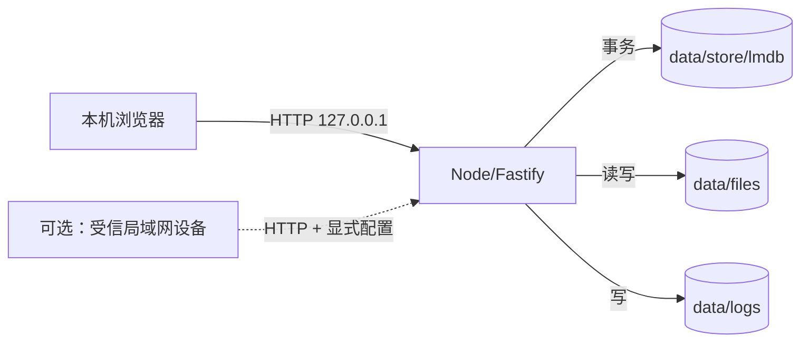

# 安全设计

> 文档状态：Draft for Review  
> 版本：0.3.0  
> 日期：2026-10-31  
> 范围：本地 HTTP、Fastify API、LMDB、本地文件系统、普通 Windows 进程  
> 说明：本文不是安全认证/合规承诺；本地 HTTP 只适用于本机或受信环境，不等同于安全的远程访问方案。

## 1. 安全目标

1. 未认证用户不能读取业务数据。
2. 已认证用户只能访问角色/数据范围/项目/文档 ACL 允许的数据。
3. 密码、会话、LMDB 文件、附件不被越权读取/篡改。
4. 审批/审计历史可追溯、可发现篡改。
5. 保留密码哈希、登录认证、RBAC、API 授权、文件权限、路径穿越防护、输入校验、CSRF、审计。
6. 默认仅本机访问；局域网开放必须显式配置并接受 HTTP 明文风险。

## 2. 资产与信任边界

| 资产 | 位置 | 保护 |
|---|---|---|
| 密码哈希 | LMDB users | Argon2id、目录 ACL |
| 会话 token | Cookie + LMDB hash | HttpOnly/SameSite、撤销 |
| 用户/组织数据 | LMDB | 认证 + 权限 + 数据范围 |
| 申请/审批 | LMDB | 申请人/审批人/管理员可见 |
| 文档/附件 | `data/files` + LMDB | ACL + 鉴权下载 |
| 审计/审批历史 | LMDB | append-only + 哈希链 |
| 日志 | `data/logs` | 目录 ACL、脱敏 |

- 默认只监听 `127.0.0.1`；不对局域网默认开放。
- 需要局域网时改监听地址；HTTP 明文可被窃听/篡改，只在受信网络使用。
- 本机管理员可访问数据目录；应用不能防拥有完全文件权限的内部人。
- 不引入 Caddy/IIS/反代/HTTPS/证书；不引入 Windows 服务包装器。

## 3. 认证

- Argon2id；memory 64MiB/t=3/p=1 基线，按机器校准。
- 密码 12–128 字符；拒绝常见弱密码；不强制复杂组合。
- 临时密码 16 字符随机，只显示一次；首次登录强制改密。
- 登录失败 5 次锁 15 分钟；IP 限流；统一错误文案；不存在用户执行 dummy 校验。
- 无默认 admin/123456；首个管理员通过初始化向导/CLI 创建。
- 密码/令牌不写日志；改密撤销其他会话。

## 4. 会话与 Cookie

- 256-bit 随机 token；LMDB 只存 SHA-256。
- 本地 HTTP：Cookie `HttpOnly; SameSite=Lax; Path=/`；不设 `Secure`（否则本地 HTTP 可能无法登录）。
- 空闲 480 分钟/绝对 7 天（可配置）；校验 revoked/expiry/user status。
- 登录创建新会话；改密/重置/停用/强制下线撤销全部会话。
- 角色变更不撤销会话，但下一请求重新加载权限。
- 单实例锁防止两个 API 进程同时写。

## 5. CSRF

- `SameSite=Lax`。
- 登录与变更请求校验 `Origin`/`Referer` 与 `WEB_ORIGIN` 一致；缺失/不匹配拒绝。
- 认证后双提交：可读 `csrf_token` Cookie + `X-CSRF-Token` Header。
- 所有 `POST/PATCH/PUT/DELETE` 校验；失败 403，无写副作用。
- 本地 HTTP 下仍保留 CSRF；不能因“内网”关闭。
- 不把 token 放 URL/日志。

## 6. 授权与数据边界

- 单组织；无多租户/`organization_id`/RLS。
- 仍需防：跨用户、跨部门、跨项目、跨文档 ACL、非当前审批人审批。
- 默认拒绝；服务端执行；前端隐藏按钮不是安全边界。
- 数据范围：self/department/department_tree/all。
- 项目角色：owner/manager/member/viewer。
- 文档 ACL：user/role/department + view/edit/manage；owner 始终 manage。
- 审批：`application:approve` + 当前步骤 active + approver 匹配。
- 具体资源越权 404；功能无权限 403；状态冲突 409。
- 管理员不能代批；只能转交并留记录。

### 6.1 防提权

- 角色分配/编辑做权限子集校验。
- 只有 org_admin 能授予管理员角色；system_admin 不能授予 org_admin。
- 不能修改自己的角色；不能停用自己；最后 org_admin 保护。
- 审计所有授权变更。

### 6.2 本地数据目录

- `data/` 仅运行进程账号 + 管理员可读写；`app/` 只读。
- 禁止放在 SMB/NFS/OneDrive/共享盘；启动检查并警告/拒绝。
- 不提供应用层静态加密；依赖 OS/磁盘访问控制。
- 不对普通用户开放文件系统路径/下载直链。

## 7. Web 安全

### 7.1 XSS

- React 转义；禁止未过滤 `dangerouslySetInnerHTML`。
- Markdown 白名单；禁止 script/style/iframe/object/embed/form 与事件属性；链接仅 http/https/mailto。
- 文件名/标题/评论/申请原因按不可信文本处理。
- CSP：`default-src 'self'`；`script-src 'self'`；`style-src 'self' 'unsafe-inline'`（AntD）；`object-src 'none'`；`frame-ancestors 'none'`。
- 安全头：`X-Content-Type-Options: nosniff`、`X-Frame-Options: DENY`、Referrer-Policy、Permissions-Policy。
- **不配置 HSTS**（本地 HTTP，无意义）。

### 7.2 JSON/输入安全

- 无 SQL；不存在 SQL 注入面；不得因此放松输入校验。
- 所有输入 Zod 严格校验；拒绝未知字段。
- 拒绝 `__proto__`/`constructor`/`prototype` 键，防原型污染。
- 不使用 `eval`/`new Function`/动态 `require`。
- 排序/筛选字段白名单，不拼接查询/键。

### 7.3 路径与文件

- 存储 key 由服务端生成；不使用原始文件名作路径。
- 拒绝 `..`、绝对路径、反斜杠；realpath 校验在 `data/files` 内。
- 上传类型白名单：PDF/DOCX/XLSX/PPTX/PNG/JPG/TXT/MD/CSV；禁止 HTML/SVG/EXE/脚本/压缩包。
- 校验扩展名 + MIME + 文件头；单文件 ≤25MB（文档）/10MB（申请附件）。
- 下载必须鉴权；`Content-Disposition: attachment`；`nosniff`；文件名 RFC 5987。
- 文件缺失/哈希不符返回错误，不返回空文件。
- 病毒扫描 P1；首版提示不要上传不可信可执行内容。

### 7.4 点击劫持/错误

- `frame-ancestors 'none'` + `X-Frame-Options: DENY`。
- 错误不返回堆栈、路径、LMDB 细节。
- 错误响应带 requestId；日志保留细节。
- 登录统一错误；不泄露账号存在性。

## 8. 数据完整性

- 关键写操作单一 LMDB 事务；失败回滚。
- 唯一索引 + 乐观锁；重复审批/提交 409。
- 审批/审计只追加；实例内/全局哈希链。
- 文件 SHA-256 + refCount + 启动对账。
- `verify` 工具：schema、索引计数、审计链、文件校验。
- 不提供备份/恢复系统；数据损坏/误删由用户自行负责。

## 9. 数据保护

- 传输：默认本机 HTTP；局域网开放必须显式配置并接受明文风险；不提供反代/HTTPS。
- 静态：不实现应用层加密；不做备份加密。
- 最小化：只收集姓名、工作邮箱、部门、岗位、上级、可选手机号；不收集身份证/薪资/健康详情。
- 日志不记录密码/token/Cookie/文件内容/完整申请正文。
- 日志保留 30 天（可配置）；审计长期；不提供备份保留策略。
- PIPL/等保适用性需法务/安全评估；当前不是合规认证。

## 10. 依赖与供应链

- 依赖锁定 + `pnpm install --frozen-lockfile`。
- LMDB 原生模块必须验证 Windows 预编译/ABI；保留来源/版本信息。
- 依赖准入看维护/许可证/漏洞；不额外建立许可证审查流程。
- `pnpm audit` 高危阻断。
- 禁止 Git URL/未知 postinstall。
- 保留第三方声明：lmdb MIT、LMDB OpenLDAP 2.8、LZ4 BSD-2。
- 不引入参考产品代码/AGPL/GPL 代码。

## 11. 本地运行安全

- 普通 Windows 用户运行；不使用服务账号/服务注册。
- 程序目录只读；数据目录不放共享/同步盘。
- 默认仅本机；局域网开放需改 `HOST`，并提示 HTTP 风险。
- 防火墙仅在用户主动开放时放行端口。
- 远程维护使用受控远程桌面/VPN（如有）。
- 单实例锁；端口占用/双实例拒绝。
- 升级：停止进程 → 迁移/verify → 启动；不提供自动备份/回滚。
- 日志/审计/数据目录 ACL。

## 12. 安全测试

| 类型 | 内容 | 门禁 |
|---|---|---|
| 认证 | 登录/锁定/改密/会话撤销 | 必过 |
| CSRF | 缺失/错误 token、跨 Origin | 必过 |
| 授权 | 角色/数据范围/项目/文档 ACL/审批 | 必过 |
| IDOR | 跨用户/部门/项目/文档 | 必过 |
| 输入 | 原型污染、Markdown、路径、文件名 | 必过 |
| 上传 | 类型伪装、超大、路径穿越、下载头 | 必过 |
| 存储 | 事务回滚、崩溃、索引重建 | 必过 |
| 依赖 | 高危漏洞 | 发布门禁 |
| 配置 | Cookie/CSRF/安全头/本地监听 | 必过 |

## 13. 已知风险

| 风险 | 影响 | 处理 |
|---|---|---|
| 本地 HTTP 明文 | 局域网开放可被窃听/篡改 | 默认仅 127.0.0.1；开放需显式配置并接受风险 |
| 无 MFA | 管理员账号被盗 | 强密码/锁定/最小权限；P1 MFA |
| 本机管理员可读数据 | 内部人风险 | OS ACL/审计；不宣称绝对防 |
| 无应用层加密 | 设备/目录被读 | 不实现；用户自行评估 OS/磁盘安全 |
| LMDB 无页校验/repair | 损坏 | 检测/停止/保留现场；无备份恢复 |
| 原生模块 | 安装/ABI 失败 | 预编译验证/保留来源 |
| 无病毒扫描 | 恶意文件 | 类型白名单/attachment；P1 ClamAV |
| 无反代/HTTPS | 局域网明文 | 明确风险，不默认开放 |
| 无 Windows 服务 | 进程退出即停止 | 手动启动；非高可用 |

## 14. 安全验收清单

- [ ] 无 SQL/ORM/数据库服务/Docker。
- [ ] 无默认账号；Argon2id；登录限流/锁定。
- [ ] Cookie/CSRF/安全头正确；本地 HTTP 不设 Secure。
- [ ] 默认仅 127.0.0.1；局域网开放有显式配置/风险提示。
- [ ] 权限矩阵/数据范围/项目角色/文档 ACL/审批步骤测试通过。
- [ ] 跨用户/部门/项目/文档 IDOR 404。
- [ ] 上传/下载/路径/文件名安全。
- [ ] 审批/审计只追加 + 哈希链可校验。
- [ ] 数据目录 ACL；日志无敏感信息；错误无堆栈。
- [ ] 无备份/恢复功能（按最新决策）。
- [ ] 上线前安全评审（至少本机/受信网络）。

