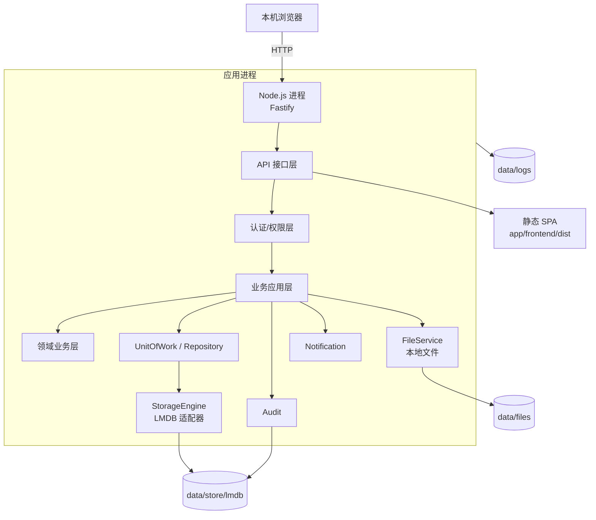
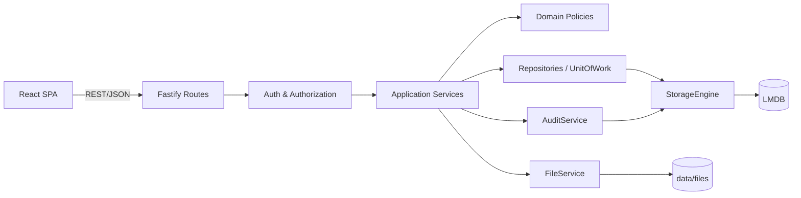
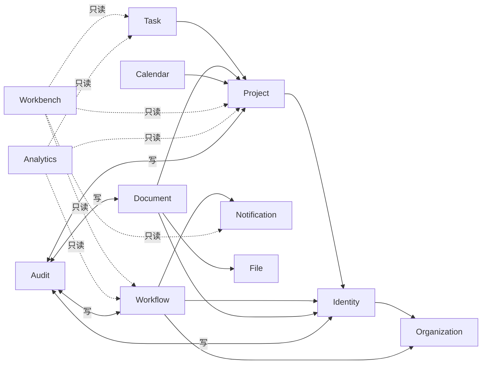
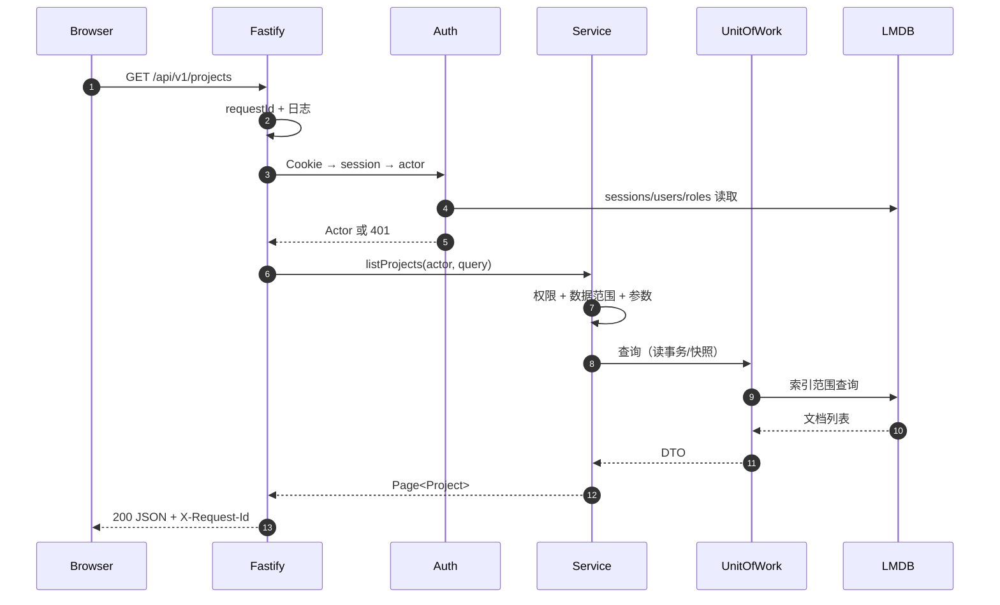

# 系统架构设计

> 文档状态：Draft for Review  
> 版本：0.2.0  
> 日期：2026-10-31  
> 架构：单组织 + 模块化单体 + 嵌入式 LMDB + 本地文件系统 + 本机 Node.js  
> 明确约束：无 SQL、无 ORM、无独立数据库服务、无 Docker/Kubernetes、无多租户  
> 关联：[数据存储设计](data-storage-design.md)、[数据模型图](data-model-diagram.md)、[技术决策](technology-decisions.md)

## 1. 架构目标

1. Windows 本机可部署，不需要用户安装数据库服务。
2. 默认本机浏览器访问；可选受信局域网访问（需显式配置）。
3. 程序与数据分离，升级不破坏数据。
4. 业务模块边界清晰，数据访问统一经 Repository/UnitOfWork。
5. 关键写操作原子；审批/审计历史不可覆盖。
6. 具备崩溃恢复、索引重建、数据校验能力。
7. 结构足够简单，单人 + AI 可维护。

## 2. 总体架构



九层：

1. 前端展示层。
2. API 接口层。
3. 身份认证与权限层。
4. 业务应用层。
5. 领域业务层。
6. 数据存储抽象层。
7. 嵌入式 KV 存储层。
8. 本地文件系统层。
9. 日志、审计与运行监控层。

## 3. 运行模型

- 一个 Node.js 进程（Fastify）同时提供：
  - `/api/v1/*` API；
  - 构建后的 SPA 静态文件；
  - 健康检查；
  - 文件下载。
- 单端口（默认 `3000`），默认绑定 `127.0.0.1`；需要局域网时显式改为 `0.0.0.0`/网卡 IP。
- 单实例锁：`data/locks/app.lock`；已存在活进程时拒绝启动。
- 不使用反向代理/HTTPS；本地 HTTP 运行。局域网开放时须接受明文风险。
- 不依赖 Redis、消息队列、Elasticsearch、独立数据库。
- 不在应用内启动多个 worker/进程；后台维护任务（清理/索引校验）以定时器运行，互斥。

## 4. 逻辑分层



| 层 | 职责 | 禁止 |
|---|---|---|
| 前端 | 展示、交互、表单体验校验 | 作为权限/业务规则唯一来源 |
| API | HTTP 解析、认证、调用用例、序列化 | SQL/存储细节、业务规则 |
| 认证/权限 | 会话、权限码、数据范围、资源守卫 | 只靠菜单隐藏 |
| 应用服务 | 用例、事务、审计、通知、跨域编排 | 直接打开 LMDB |
| 领域 | 状态机、审批人解析、ACL、引用规则 | HTTP/存储实现 |
| 存储抽象 | Repository、UnitOfWork、索引、schema | 业务决策 |
| KV 适配 | LMDB 事务/子库/校验 | 暴露给业务模块 |
| 文件 | 本地文件写入/读取/校验/清理 | 直接暴露路径 |
| 日志/审计 | 可观测、可追溯 | 记录敏感明文 |

## 5. 模块边界



- 箭头表示依赖公开服务/只读查询，不是数据表外键。
- 模块间禁止直接访问对方 Repository/命名子库；通过应用服务或只读 Query Port。
- 工作台/分析是只读组合层，不建业务数据。
- Audit 是叶子服务，不反向依赖业务模块。

## 6. 请求生命周期



写请求：

```text
认证 → 权限 → 参数校验 → UnitOfWork 写事务
  → 读当前文档/版本校验
  → 唯一索引校验
  → 写实体 + 索引 + 审计/通知
  → COMMIT
  → 返回新 version
```

## 7. 数据访问

- 唯一入口：`StorageEngine` → `Repository` → `UnitOfWork`。
- 业务模块不得导入 `lmdb`，不得读写 `data.mdb`。
- 每个实体有 `Repository`；跨实体写由应用服务开启一个事务。
- 列表查询必须走索引；禁止全库扫描。
- 分页使用索引游标或 `offset/limit`；首版可用 `offset/limit`，大列表后续优化。
- 读多写少；读使用 LMDB 快照，写串行。
- 索引可重建；启动/维护任务校验索引计数。

## 8. 文件系统

- 文件内容：`data/files/<sha256前2位>/<sha256>`，内容寻址、去重。
- 上传：临时文件 → fsync → 原子 rename → 元数据事务 → 失败补偿。
- 下载：鉴权后流式读取；不暴露绝对路径。
- 删除：元数据软删 + refCount 减一；零引用移入 `trash`，延迟清理。
- 启动对账：missing/orphan/pending 文件处理。
- 不提供备份/恢复；文件完整性由 SHA-256/对账保证。

## 9. 认证与权限

- 数据库会话改为 **LMDB 会话文档**；浏览器仍只持有随机 token。
- Cookie `HttpOnly/SameSite=Lax`（本地 HTTP 不设 Secure）；token 只存 SHA-256。
- RBAC：用户内嵌 `roleIds`；角色内嵌 `permissionCodes`；数据范围 `self/department/department_tree/all`。
- 项目角色、文档 ACL、菜单/API 权限仍保留。
- 所有资源访问在服务端校验；前端隐藏按钮不是安全边界。
- 单组织：无 `organizationId`、无跨组织 IDOR；仍需防跨用户/跨部门/跨项目越权。

## 10. 审批引擎

- 模板 → 版本快照 → 实例 → 步骤 → 审批记录。
- 提交时解析全部审批人并写入步骤快照。
- 顺序单审批人；通过/驳回/撤回/管理员转交。
- 审批动作在单一 LMDB 事务中：
  - 校验实例 running、步骤 active、审批人匹配；
  - 追加审批记录（实例内哈希链）；
  - 更新步骤/实例/申请；
  - 写通知 + 审计；
  - 提交。
- 重复审批由状态 + 唯一索引 + 版本校验拒绝。
- 模板新版本不影响进行中实例。

## 11. 部署（Windows 优先）

```text
C:\EnterprisePlatform\
├─ app\
│  ├─ backend\        # node dist/server.js
│  ├─ frontend\dist\  # SPA
│  └─ shared\
├─ data\
├─ scripts\
├─ config.example.json
└─ start.bat / install-service.ps1
```

启动：

```powershell
cd C:\EnterprisePlatform
$env:NODE_ENV="production"
$env:PORT="3000"
node app\backend\dist\server.js
```

- 浏览器访问 `http://<服务器IP>:3000`。
- 默认不开放防火墙；需要局域网时由用户显式放行端口。
- 普通进程启动/停止；不注册 Windows 服务；运行账号仅访问 `data/`。
- 不引入 IIS/Caddy/反代/HTTPS/证书；不做 Docker。
- 程序目录只读；数据目录可写；日志独立。
- 升级：停止进程 → 替换 `app/` → 运行迁移/校验 → 启动；不提供自动备份/回滚。
- 不要求安装 PostgreSQL/MySQL/SQLite/任何数据库服务。

## 12. 日志与审计

- 应用日志：Pino JSON 到 stdout + `data/logs` 轮转文件；保留 30 天（可配置）。
- 审计：LMDB `audit_logs`，全局哈希链；关键操作同事务写入。
- 审批记录：实例内哈希链；只追加。
- 不提供备份/恢复系统；仅保留日志/审计。
- 恢复：停服 → 校验 → 恢复 store/files → verify → 启动。
- 数据校验：schema、索引计数、审计链、文件 SHA-256。
- 不把日志/审计写入单个不可轮转文件。

## 13. 可观测性

| 能力 | 方案 |
|---|---|
| 结构化日志 | Pino JSON；requestId/userId/route/status/duration |
| 健康检查 | `/health/live`、`/health/ready`（LMDB 可读、schema 版本、数据目录可写） |
| 慢操作 | 应用计时；>500ms 记录（脱敏） |
| 存储指标 | `data.mdb` 大小、文件数、索引计数 |
| 错误 | 统一 problem+json；requestId；不返回堆栈 |
| 审计 | 管理端查询；`verify` 工具 |

## 14. 性能与容量

- 目标：500 活跃用户、5 万任务、10 万申请、文档 ≤100GB。
- 原型：50k 任务写入 1.46s；索引查询 7.84ms；1000 次读取 3.89ms；RSS 65MB；DB 25.7MB。
- 索引覆盖列表；工作台并行查询；首屏限制条数。
- 大文件流式；不读入内存。
- 索引重建/迁移在维护模式。
- `mapSize` 2–4GB 虚拟预留；数据文件接近 50% 时告警/扩容（需重启）。
- 不做 Redis 缓存；若瓶颈，先索引/查询优化，再评估请求级缓存。

## 15. 故障与恢复

| 故障 | 行为 |
|---|---|
| 进程崩溃 | LMDB 恢复最后已提交事务；启动对账 |
| 文件写入后 DB 失败 | 补偿删除；启动 orphan 扫描 |
| DB 页损坏 | 停止写；保留现场；不提供自动恢复 |
| 磁盘满 | 健康检查失败；只读/维护模式；清理 tmp/trash/logs |

| 索引损坏 | 维护模式重建；不把索引当数据源 |
| 端口占用/双实例 | 单实例锁拒绝启动 |
| 网络共享数据目录 | 启动警告/拒绝（LMDB 不适合 SMB/NFS） |

## 16. 架构决策

| 决策 | 说明 |
|---|---|
| 单组织 | 无 organizationId/多租户 |
| 模块化单体 | 一个 API 进程，不拆微服务 |
| 嵌入式 LMDB | 无独立数据库服务，ACID |
| JSON 文档 + 索引子库 | 不做单 JSON 文件/全表扫描 |
| 本地文件系统 | 无对象存储依赖；内容寻址 |
| 本机 Node 托管 SPA | 单端口、无 Docker |
| 审计/审批哈希链 | 可发现篡改（非绝对防管理员） |
| 无备份系统 | 简化运行；数据安全由用户负责 |

## 17. 验收清单

- [ ] 无 SQL/ORM/数据库服务/Docker。
- [ ] 单组织，无 `organizationId`。
- [ ] 所有写经 UnitOfWork；无模块直接访问 LMDB。
- [ ] 关键写事务原子；失败回滚。
- [ ] 审批/审计只追加且可校验。
- [ ] 文件/元数据一致。
- [ ] 崩溃恢复、索引重建测试通过。
- [ ] Windows 本机部署文档可执行。
- [ ] 默认本机访问与单实例锁验证；局域网为显式可选项。


