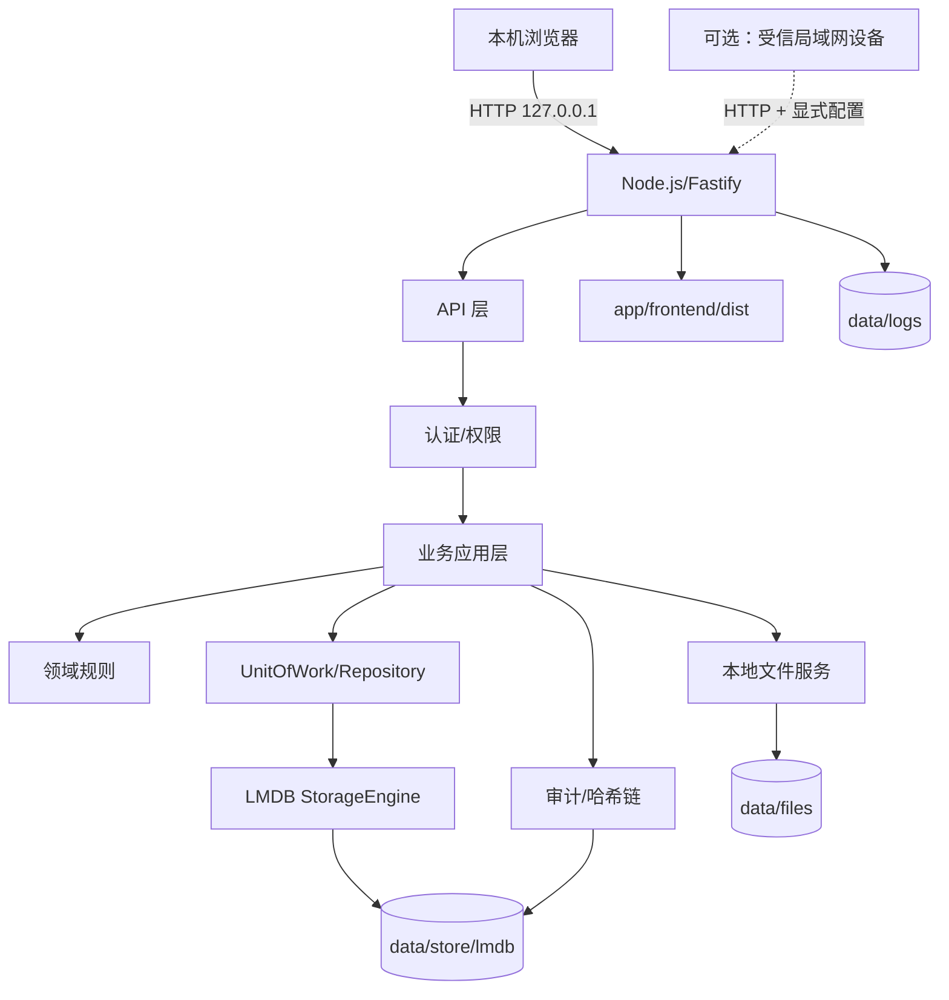

# 第一阶段技术架构重构审查报告

> 项目：企业协同与事务管理平台（Enterprise Collaboration & Office Management Platform）  
> 阶段：第一阶段 · 技术架构重构  
> 日期：2026-10-31  
> 审查状态：**通过（文档阶段；后续已明确批准进入 R1/M0）**
> 结论：按最新人工决策完成单组织、Windows 本地 HTTP、普通进程、LMDB、本地文件、无备份/无反代/无服务的架构修订。  
> 正式业务代码/正式依赖/正式数据目录：**未开始**。

> 阶段说明：本报告记录 2026-10-31 文档审查时的建议；其中等待人工审核后才进入 R1/M0 的表述已被后续明确批准取代。当前 M0 状态与门禁见 [AGENTS.md](../AGENTS.md) 和 [M0 验收报告](04-development/M0-acceptance-report.md)。

## 1. 原架构问题清单

| # | 原架构 | 与新约束冲突 | 影响 |
|---|---|---|---|
| 1 | PostgreSQL 17 + Prisma ORM | 禁止 SQL/ORM/独立数据库服务 | 数据模型、事务、迁移、测试不可用 |
| 2 | Docker Compose 部署 | 禁止 Docker/K8s | 部署流程不可执行 |
| 3 | 多组织预留 `organization_id` | 单组织、不做多租户 | 字段/权限/索引/测试冗余 |
| 4 | SQL 表/外键/唯一约束/部分索引 | 无 SQL | 需重新设计 KV 键空间/索引 |
| 5 | Prisma Migration | 无 ORM/无 SQL 迁移 | 需 schemaVersion + 停机迁移 |
| 6 | PostgreSQL 行锁/事务 | 无数据库服务 | 审批/编号并发改用 LMDB 写事务 |
| 7 | `pg_dump` + 数据库备份 | 无数据库服务；且不建设备份系统 | 删除备份规划，不保留备份模块 |
| 8 | 文档中心被拆为最小闭环 | 不得人为缩减功能 | 产品范围冲突 |
| 9 | 测试依赖 PostgreSQL service | 无数据库/无 Docker | 测试基础设施不可用 |
| 10 | 安全设计依赖 RLS/SQL/HTTPS/反代 | 无 SQL/RLS；本地 HTTP/无反代 | 改为单组织数据边界 + 本地 HTTP 安全 |
| 11 | Windows 服务/任务计划/反代 | 普通进程、本地 HTTP、无服务包装 | 部署方案不可用 |
| 12 | README/AGENTS/决策记录仍写 SQL/Docker/多组织/备份 | 文档自相矛盾 | 后续实现会按错误方向执行 |

## 2. 本次修改文件清单

### 2.1 重命名

| 旧 | 新 |
|---|---|
| `docs/03-technical/database-design.md` | `docs/03-technical/data-storage-design.md` |
| `docs/03-technical/er-diagram.md` | `docs/03-technical/data-model-diagram.md` |

### 2.2 实质修订

| 文件 | 修改原因 |
|---|---|
| [README](../README.md) | 新架构、运行方式、文档导航、状态 |
| [AGENTS.md](../AGENTS.md) | 新工程契约；删除备份/服务/反代要求 |
| [project-init.md](00-project/project-init.md) | 目录、环境、依赖、普通进程启动 |
| [glossary.md](00-project/glossary.md) | LMDB/键空间/UnitOfWork；删除 SQL/RLS |
| [decision-log.md](00-project/decision-log.md) | Q-015～Q-019 关闭；删除备份/加密/反代/服务规划 |
| [product-overview.md](01-product/product-overview.md) | 单组织、本机部署、完整文档中心 |
| [product-requirements.md](01-product/product-requirements.md) | 删除 SQL/Prisma/备份/HTTPS；本机 HTTP NFR |
| [user-roles.md](01-product/user-roles.md) | 数据范围 all；单组织；删除备份运维 |
| [user-stories.md](01-product/user-stories.md) | 跨组织改跨用户/部门/项目；完整文档中心 |
| [mvp-scope.md](01-product/mvp-scope.md) | R1 交付顺序；完整文档中心；无备份/服务 |
| [business-architecture.md](02-business/business-architecture.md) | 单组织/KV/UnitOfWork；删除 SQL/RLS/JOIN |
| [business-processes.md](02-business/business-processes.md) | 数据参与者改 LMDB；删除备份/恢复流程 |
| [project-management.md](02-business/project-management.md) | 任务序号/唯一索引改 KV；删除 SQL |
| [oa-workflow.md](02-business/oa-workflow.md) | 编号/幂等/并发改 LMDB 事务 |
| [permission-model.md](02-business/permission-model.md) | 单组织数据边界；删除组织隔离/RLS |
| [system-architecture.md](03-technical/system-architecture.md) | 本机 HTTP、默认 localhost、普通进程、无备份/反代/服务 |
| [data-storage-design.md](03-technical/data-storage-design.md) | KV/索引/事务/文件/迁移；删除备份/加密 |
| [data-model-diagram.md](03-technical/data-model-diagram.md) | 业务实体/引用/键空间图 |
| [api-design.md](03-technical/api-design.md) | 删除 SQL/org 参数；加存储错误/幂等 |
| [security-design.md](03-technical/security-design.md) | 本地 HTTP、Cookie/CSRF、无 HTTPS/备份加密 |
| [technology-decisions.md](03-technical/technology-decisions.md) | 存储/运行/安全决策；Q-015～019 关闭 |
| [development-guide.md](04-development/development-guide.md) | 无 DB/Docker/服务；普通进程启动；本机 HTTP |
| [testing-strategy.md](04-development/testing-strategy.md) | LMDB 临时目录；崩溃/并发/索引；删除备份测试 |
| [development-roadmap.md](04-development/development-roadmap.md) | 16 周；M0 存储；删除备份/服务/反代 |
| [acceptance-criteria.md](04-development/acceptance-criteria.md) | 本机 HTTP/普通进程验收；删除备份门禁 |
| [reference-products.md](05-research/reference-products.md) | 部署/多租户对比更新 |
| [dependency-compliance.md](05-research/dependency-compliance.md) | LMDB 来源/版本/许可证记录；不设额外审查流程 |
| [embedded-storage-evaluation.md](05-research/embedded-storage-evaluation.md) | 原型记录；不包含产品备份设计 |
| [phase-1-review.md](06-review/phase-1-review.md) | 旧报告改为历史入口 |
| 本报告 | 新增审查报告 |

### 2.3 未改/保留

- 产品功能、角色、状态机、审批业务规则保留；只改存储/部署/运行冲突部分。
- 项目外原型脚本未复制进项目；未安装正式项目依赖。
- 未开发正式业务模块/API/页面。

## 3. 产品需求保留情况

| 模块 | 原需求 | 本次处理 |
|---|---|---|
| 工作台 | 待办/待我审批/通知/最近项目/概览 | 保留 |
| 项目管理 | 项目/成员/状态/任务/看板/进度/评论 | 保留 |
| OA | 五类申请/审批流程/历史 | 保留 |
| 组织 | 架构/部门/员工/岗位/角色/权限 | 保留 |
| 系统 | 用户/角色/日志/配置 | 保留 |
| 文档 | 文件/分类标签/搜索/版本/权限 | **完整保留** |
| 日程 | 个人/项目/会议/提醒 | 保留为 P1 完整规划 |
| 统计 | 完成率/逾期/审批耗时/部门工作量/报表 | 保留为 P1 完整规划 |

结论：**没有删除原有功能模块**。R1/P1 是交付顺序，不是产品功能上限。

## 4. 新总体架构



- 单组织、单 Node 进程、单 SPA、单 LMDB 环境、本地文件。
- 默认监听 `127.0.0.1`，仅本机访问；局域网需显式配置并接受 HTTP 明文风险。
- 普通进程启动/停止；不注册 Windows 服务；无反代/无 TLS/无 Docker/无 DB 服务。
- 无自动备份/异地备份/备份管理/备份恢复界面。

## 5. 最终存储选型

**确定使用 `lmdb@3.5.9`**（人工决策 2026-10-31）。保留依赖来源、版本与许可证信息；不额外建立许可证审查流程。

原型环境：Windows 10.0.19045 64 位、Node 24.17.0、pnpm 11.18.0；项目外临时目录。  
详细见 [嵌入式存储评估](05-research/embedded-storage-evaluation.md)。

| 能力 | 结果 |
|---|---|
| CRUD/唯一索引 | ✅ |
| 100 并发事务读改写 | ✅ 100/100 |
| 两进程并发写 | ✅ 600/600 |
| 强杀恢复 | ✅ 4146/4146/4146 一致 |
| 索引重建 | ✅ |
| 50k 任务写入 | 1.46s（约 34k/s） |
| 索引查询 | 5000 条 7.84ms |
| 1000 次按 ID 读取 | 3.89ms |
| RSS / DB | 65MB / 25.7MB |


## 6. KV 数据结构和索引

- 每实体一个命名子库；索引独立子库，可重建。
- JSON 文档信封：`id/type/schemaVersion/version/createdAt/updatedAt/deletedAt`。
- 主键 UUIDv7；复合键 `\u001F` 分隔；数字零填充；前缀范围查询。
- 唯一约束：唯一索引键 -> 实体 ID；冲突 409。
- 实体：users/sessions/roles/permissions/login_records/org_profile/departments/positions/settings/projects/project_members/tasks/task_comments/applications/application_attachments/workflow_*/approval_records/documents/document_versions/categories/tags/document_tags/document_acl/files/events/reminders/notifications/audit_logs/counters/idempotency。
- 无 `organization_id`；组织为单例 `org_profile`。

## 7. 数据事务与一致性

- `UnitOfWork.run` = 一个 LMDB 写事务；跨仓储共享事务上下文。
- 关键用例：提交申请、审批、任务创建、文件上传均在一个事务或“文件+事务+补偿”内完成。
- `version` 乐观锁 + 唯一索引 + 状态校验防并发重复。
- 审计全局哈希链；审批实例内哈希链；索引可重建。
- 事务短小；不做文件/网络 IO。

## 8. 文件存储方案

- 临时文件 → fsync → SHA-256 → 原子 rename → `data/files/<前2位>/<sha256>`。
- `files` 元数据 + refCount；文档版本/申请附件引用 fileId。
- 下载鉴权 + 流式 + attachment；不暴露路径。
- 删除软删 + refCount → trash 延迟清理。
- 启动/定时对账 missing/orphan/pending。
- 无备份系统；无备份目录/manifest/恢复 UI。

## 9. 权限架构

- 单组织；无多租户/`organization_id`/RLS。
- 保留 RBAC、数据范围 self/department/department_tree/all、项目角色、文档 ACL、菜单/API 权限、审计。
- 后端默认拒绝；前端隐藏不是安全边界。
- 管理员不能代批；只能转交。
- 文件下载走 ACL + 鉴权。

## 10. 审批引擎

- 模板版本快照 + 实例 + 步骤 + 追加记录；顺序单审批人。
- 一个 LMDB 写事务内读实例/步骤 + 追加记录 + 更新状态 + 通知 + 审计。
- 实例内哈希链；每步最多一条 approve/reject；每实例最多一条 withdraw。
- 模板新版本不影响进行中实例；审批人失效由管理员转交。
- 不支持会签/或签/条件/委托；P1 再评估。

## 11. 本地运行方案

```text
C:\EnterprisePlatform\
  app\frontend\dist
  app\backend\dist
  app\shared
  data\{config,store\lmdb,files,logs,tmp,trash,locks}
  scripts\start.cmd
```

- 启动：双击/命令行 `start.cmd` 或 `node app\backend\dist\server.js`。
- 停止：终端 `Ctrl+C` 或关闭进程窗口；不注册 Windows 服务。
- 默认 `HOST=127.0.0.1`；浏览器访问 `http://127.0.0.1:3000`。
- 需要局域网：显式改 `HOST=0.0.0.0` 或指定网卡 IP，并接受 HTTP 明文风险；不做默认开放。
- 无 Caddy/IIS/反向代理/HTTPS/证书；无 WinSW/NSSM/服务注册。
- 无 Docker/数据库服务。
- 程序目录只读；`data/` 可写；单实例锁 `data/locks/app.lock`。

## 12. 运行数据与恢复

- R1 **不建设备份功能**：无自动备份任务、异地备份、保留策略、备份加密、备份 UI。
- 不提供 RPO/RTO 承诺。
- 数据损坏/误删时：停止进程、保留现场；产品不提供恢复能力。
- 仍保留：应用日志、操作审计、错误日志；用于运行与审计，不是备份系统。
- 保留存储 `verify`/索引重建用于完整性检查，不提供备份恢复管理。

## 13. 安全风险

| 风险 | 影响 | 处理 |
|---|---|---|
| 本地 HTTP 明文 | 若开放局域网，可能被窃听/篡改 | 默认仅 127.0.0.1；开放局域网需显式配置并接受风险；不宣称安全远程方案 |
| 无 MFA | 管理员账号被盗 | 强密码/锁定/最小权限；P1 MFA |
| 本机管理员可读数据 | 内部人风险 | OS ACL/审计；不宣称绝对防 |
| 无应用层加密 | 设备/目录被读 | 不实现；由用户自行评估 OS/磁盘安全 |
| LMDB 无页校验/repair | 数据损坏 | 检测/停止/保留现场；无备份恢复功能 |
| 原生模块 | 安装/ABI 失败 | 预编译验证；保留来源/版本 |
| 无病毒扫描 | 恶意文件 | 类型白名单/下载 attachment；P1 ClamAV |
| 无反代/HTTPS | 局域网明文 | 明确风险；不默认开放 |
| 无 Windows 服务 | 进程退出即停止 | 用户手动启动；不是高可用服务 |

## 14. 性能风险

| 风险 | 说明 | 处理 |
|---|---|---|
| 50k+ 数据 | 索引/内存映射 | 已测 50k；100k 需压测 |
| 工作台聚合 | 多查询 | 并行/限条数 |
| 看板重排 | O(列任务) | 500 内可接受 |
| 索引重建/迁移 | 停写 | 维护模式 |
| 杀毒软件 | I/O 抖动 | 目标机压测 |
| 单写者 | 写吞吐上限 | 短事务/批量 |
| 大文件 | 磁盘/流式 | 限制/流式/容量监控 |

## 15. 未解决问题

| 项 | 状态 |
|---|---|
| Q-015 LMDB 选型 | **已关闭：确定使用 LMDB** |
| Q-016 备份 | **已关闭：不建设备份系统** |
| Q-017 静态加密 | **已关闭：暂不实现** |
| Q-018 HTTPS/反代 | **已关闭：本地 HTTP，不引入** |
| Q-019 Windows 服务 | **已关闭：普通进程** |
| 真实断电/24h soak | 未验证，R1 前按需评估 |
| 100k 申请/大文件压测 | 未验证 |
| 等保/PIPL/法务 | 未评估；本地 HTTP 场景需用户确认 |
| UI 线框/高保真 | 未做 |

## 16. 后续正式开发建议

1. （历史建议，已被后续明确批准取代）人工审核本报告后进入 R1/M0；当前不得将此条当作现行门禁。
2. M0 先做 StorageEngine/Repository/UnitOfWork + 事务/崩溃/索引测试，不先做页面。
3. 实现 `data:init`、`storage:verify`、`storage:rebuild-indexes`；**不实现 backup/restore**。
4. 默认 `HOST=127.0.0.1`；局域网开关与风险提示写入启动配置/UI。
5. 保留 LMDB 来源/版本/许可证信息；不建立额外许可证审查流程。
6. 普通进程启动脚本；不注册服务；不做反代/HTTPS。
7. 文档中心按完整范围实现。
8. 多组织/外部访客/SQL/Docker 不进入 R1。

## 17. 文档一致性检查

- [x] Q-015～Q-019 已关闭，不再作为待实施/待确认项。
- [x] 活跃架构/开发/验收文档删除自动备份、异地备份、备份保留/加密/恢复 UI。
- [x] 删除 Caddy/IIS/反代/HTTPS/证书规划。
- [x] 删除 WinSW/NSSM/Windows 服务注册；改为普通进程。
- [x] 默认仅本机访问；局域网需显式配置。
- [x] 单组织、LMDB、本地文件、本机 Node 贯穿全部文档。
- [x] 文档中心完整范围，无人为最小闭环。
- [x] 审批/审计 append-only + 哈希链一致。
- [x] 文件一致性/事务/崩溃/索引在存储、测试、验收一致。
- [x] 链接与文件名更新；无旧 `database-design.md`/`er-diagram.md` 引用。
- [ ] Mermaid CLI 未运行渲染；需 Markdown 预览确认。

## 18. 阶段验收结论

**状态：通过（文档阶段）。**

符合：

- 单组织；
- Windows 本地运行；
- 无 SQL/ORM/数据库服务；
- 无 Docker；
- LMDB + JSON + 本地文件；
- 无自动/异地备份、无备份管理/UI；
- 无 Caddy/IIS/反代/HTTPS；
- 无 WinSW/NSSM/Windows 服务；
- 普通进程启动；
- 完整产品需求保留。

后续（历史建议，已被后续批准和 2026-11-02 并行开发授权取代）：等待人工审核本报告与文档；审核通过后才进入 R1/M0。未通过前不开发正式业务模块、不安装正式依赖、不创建正式数据。现行阶段与安全边界见 [AGENTS.md](../AGENTS.md) 和 [M0 验收报告](04-development/M0-acceptance-report.md)。

